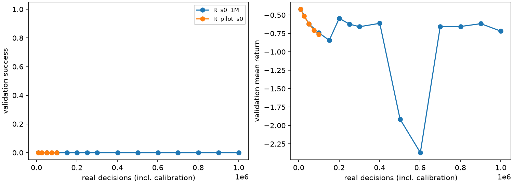

# ESE3990 M1 report: PPO baseline and native candidate rollouts

**Date:** 2026-11-13 · **Status:** M1 exit met. PPO is implemented, checked and reproducible, and native hypothetical rollouts exist. **PPO does not yet solve R:** 0/20 validation at every checkpoint up to 1M decisions (§4).
Plan: [ESE3990_SailGym_Project_Plan.md](ESE3990_SailGym_Project_Plan.md) §6 M1. Previous: [M0 report](M0_report.md).

## 1. What landed

| Change | Files |
|---|---|
| PPO: 2×64 tanh actor/critic, tanh-Gaussian likelihood, GAE with the §3.4 masks, PPO-Clip loss, minibatch epochs, checkpoint save/load, `PPOPolicy` evaluation controller. Comments cite the course slides by PDF page. | `experiments/ese3990/ppo.py` |
| Learner entry point: calibration, then frozen normalization, explicit-reset collector (every episode logged with `EpisodeRecorder`), updates, checkpoints, and probe/validation evaluation at each checkpoint | `experiments/ese3990/train.py` |
| `--controller ppo --checkpoint …` in the shared evaluator | `experiments/ese3990/evaluate.py` |
| Learning-curve figure from `curve.jsonl` | `experiments/ese3990/plots.py` |
| `RawEnv.rollout(actions (K,H,3), …)`: K forks stepped H decisions through the ordinary `step()` path, all in Rust | `crates/sailgym-py/src/env.rs` |
| `TaskEnv.rollout(rates (K,H,2))`: the vector form of the action adapter, plus scoring with the batch path of the same transition reward | `experiments/ese3990/sailing.py` |
| 12 PPO tests and 1 batch-rollout test (experiment suite: 43 pass) | `experiments/ese3990/tests/test_ppo.py`, `tests/test_branch.py` |

No physics, reward, task, condition or coefficient was changed. `tasks.json` is untouched, so M0 episode stores still replay.

## 2. E0 checks (all pass: `env -u PYTHONPATH uv run --frozen --no-sync pytest experiments/ese3990/tests`)

| Check | Test |
|---|---|
| The tanh-Gaussian log-likelihood is a density on (−1,1) and matches N(atanh a)/(1−a²) | `test_tanh_gaussian_is_a_density_on_the_action_interval` |
| The log-Jacobian is finite at saturation | `test_tanh_log_det_is_finite_where_tanh_saturates` |
| A hand-calculated GAE example with running, truncated (bootstrap from the real final state and stop the sum) and terminal (no bootstrap) rows | `test_gae_hand_example_with_truncation_and_termination` |
| GAE with λ = 1 equals the Monte Carlo return | `test_gae_with_lambda_one_is_the_monte_carlo_return` |
| The clipped surrogate's gradient in all five ratio/advantage regions (slides adv. pp. 52–54) | `test_clipped_surrogate_gradient_cases` |
| The ratio is 1, KL 0 and clip fraction 0 before an update | `test_ratio_is_one_before_the_first_update`; also logged as `first_ratio_mean` on every real update |
| Two runs with the same seed give identical metrics and identical parameters; losses are finite | `test_training_is_finite_and_reproducible` |
| A reloaded checkpoint reproduces its recorded nominal return exactly | `test_reloaded_checkpoint_reproduces_its_evaluation` |
| Every stored calibration, training, probe and validation episode replays exactly | `test_every_stored_run_episode_replays_exactly` |
| A native batch equals one Python-driven fork per candidate, bit for bit, through a truncation. Post-terminal decisions are not simulated, rewards match the scalar path, and the live episode is untouched | `test_native_batch_rollout_equals_fork_stepping_and_leaves_live_untouched` |

## 3. Measured cost (this machine, CPU JAX, one process)

| Quantity | Measured |
|---|---|
| 100k-decision PPO pilot, end to end | **14.2 s** (collection 6.3 s, updates 0.8 s, 5 checkpoint evaluations 5.9 s) |
| 1M-decision PPO run, end to end | **93 s** (collection 69 s, updates 5.2 s, 14 checkpoint evaluations 17 s) |
| Native candidate batch, K=64, H=40 | 52.6 ms per call. That is ≈ 20 µs per branch decision, against 24.7 µs driven from Python: the physics dominates |
| Baseline planner (K=64, H=40, I=3), per live decision | **≈ 158 ms** single-threaded (H=80: 314 ms; H=160: 624 ms; K=128: 317 ms) |

**Budget consequences.**

* *PPO:* runtime does not constrain the budget. 500k takes about 1 min and 1M about 1.5 min per seed, so 5 seeds × 1M is under 10 min. The common budget across PPO and SAC is still M2's decision, once SAC's per-decision update cost is measured.
* *MPC:* the baseline is about 3× over the 50 ms deadline, so it is **offline** single-threaded. One validation episode costs 50–140 s (finished at ~16 s versus truncated at 45 s). The five-setting E2 sweep (20 conditions × 3 search seeds, about 9.5 baseline-units of work) would take **8–22 h single-threaded**. Running the K candidates on several threads in `RawEnv.rollout` (24 cores here; `VecEnv` already uses rayon) is therefore the first M3 task. It brings the sweep under about 1 h and may make the baseline real-time. Correctness is unaffected.

## 4. First PPO R curve (seed 0, plan §4.5 starting values, unchanged)

Regenerate it with `uv run --frozen --no-sync python experiments/ese3990/plots.py runs/ese3990/ppo/R_s0_1M runs/ese3990/ppo/R_pilot_s0 --out docs/ese3990/figs/M1_ppo_R_curve.png`.

| Decisions | 10k | 100k | 250k | 500k | 600k | 1M |
|---|---|---|---|---|---|---|
| Validation success | 0/20 | 0/20 | 0/20 | 0/20 (3 mark missed) | 0/20 (4 mark missed) | 0/20 |
| Validation mean return | −0.42 | −0.74 | −0.62 | −1.91 | −2.37 | −0.72 |

**Diagnosis. The implementation is not at fault; the cause is exploration under this reward.** Evidence:

* Updates are well behaved. Approximate KL is 0.003–0.004, clip fraction 3–5%, gradient norms are finite and σ shrinks slowly from 0.61 to 0.5.
* Training outcomes per 100 episodes: all truncated until episode ~500. Episodes 500–700 then produce **6 finishes and 19 mark-misses**. After that the policy returns to truncation, and validation mean return recovers from −2.4 to −0.7.
* Under the frozen reward, a mark-miss costs −10, and a 45 s drift that ends near the gate costs about −0.3 to −0.7. Reaching the gate line is therefore worth trying only once the policy hits the 10 m gate reliably. White Gaussian noise on rates, resampled at 20 Hz, mostly averages out in the actuators. The sheet starts fully eased (4.5 m), and every constant-rate action fails: they drift to (17, −6) or miss the mark. PPO found the gate and then learned that approaching it was not worth the risk.

This is a pilot result, not a final claim: one seed, starting values. The plan allows two more 100k pilot configurations on validation for PPO. Candidates, **not applied**, are:

1. Larger initial σ (log σ = 0), or time-correlated exploration noise.
2. A higher entropy coefficient.

**Update:** both were tried on pilot seeds 100–102; see [`docs/rl/ppo_tuning_log.md`](../rl/ppo_tuning_log.md). The unchanged baseline solves R on seed 101 (20/20 from 400k). σ₀ = 1 is worse, and c_H = 0.01 is slower. The baseline is kept, and seed variance dominates.

Changing the reward or the gate is **not** a pilot option; it would reopen the frozen M0 contract. The choice is yours. Record whichever is taken here before the final runs.

## 5. Frozen normalization protocol (plan §3.3, §4.5)

* 10,000 smooth-random decisions (`SmoothRandom(seed, hold=10)`) at the start of every training run, on conditions from `TrainingSampler(seed)`. It is a function of the training seed only, so SAC reuses identical data. The decisions are charged to the budget, and the episodes are stored with `kind="calibration"`.
* Mean and standard deviation per feature over the 17 `sailing.FEATURE_NAMES` at decision start. The standard deviation is floored at 0.01, and normalized inputs are clipped to ±5 (slides adv. p. 59, tricks 4–5). The values are saved in every checkpoint's `.json`.
* Only `capsize_pending` hits the floor: it never moved during seed-0 calibration.
* No pilot-only correction was made to the task or protocol in M1.

## 6. Notes for M2/M3

* Build and test with `uv run --frozen --no-sync …`. A plain `uv run` re-syncs from the lock and silently reinstalls a stale cached `sailgym_core` wheel without `fork`, `rollout` or `research_state`. The README now says this.
* SAC must reuse `train.calibrate`, `train.Collector` and `ppo.normalize` so that the calibration data and actor features are identical.
* The probe set is `train.PROBE_IDS`: nominal plus the first five validation documents. Every checkpoint evaluates nominal and all 20 validation documents and stores them, with the probe subset tagged `kind="probe"`.
* The entropy bonus uses the pre-squash Gaussian entropy, marked with `shortcut:` in `ppo.entropy`. This is harmless at c_H = 0.001.
* The Rust gate (steps 1–5) was not rerun in full; only `sailgym-py` changed. `cargo fmt --check`, `cargo clippy -p sailgym-py --all-targets -D warnings` and `scripts/py-test.sh` pass.
