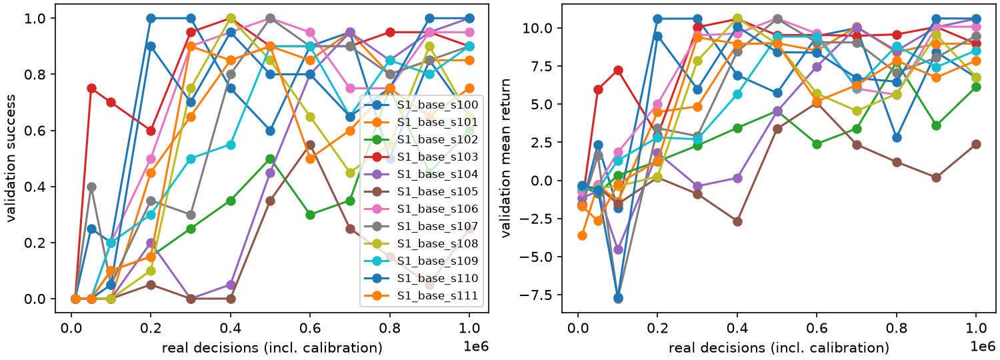

# ESE3990 M2 report: SAC and the learner configuration freeze

**Status:** M2 exit met. SAC and PPO train/evaluate through the same frozen
SailGym contract; numerical checks, stored-run checks and replay pass. Six
main runs are queued/running, not claimed complete. Completing them and the
held-out comparison belongs to M4. The pilot allowance was exceeded before
this audit; that deviation remains part of the result.

**Configuration freeze:** 2026-11-13 04:59 UTC (Nov 12, 23:59 EST).
Plan: [M2](ESE3990_SailGym_Project_Plan.md#6-milestones-and-task-backlog).
Previous: [M1 report](M1_report.md).

## Implementation and explanation

[`sac.py`](../../experiments/ese3990/sac.py) implements only replay, the
state-dependent tanh-Gaussian actor, two critics, two target critics, three
losses, and the update. It reuses PPO's MLP, corrected Gaussian likelihood,
optimizer, normalization and checkpoint format. No extra RL dependency,
network framework or boat model was introduced.

The comments use **PDF page numbers**, not the slide's printed footer.
The page references were checked against the local PDFs with `pdftotext`.

| Code | Slides | Explanation |
|---|---|---|
| `Replay` | [Foundations pp. 431, 437–438](ESE3990_slides_L1-L13_foundations.pdf#page=431); [Advanced p. 86](ESE3990_slides_L14-L19_advanced_topics.pdf#page=86) | Uniform minibatches reuse old-policy transitions |
| `soft_target`, `critic_loss` | [Advanced pp. 150–151](ESE3990_slides_L14-L19_advanced_topics.pdf#page=150), [137](ESE3990_slides_L14-L19_advanced_topics.pdf#page=137), [106](ESE3990_slides_L14-L19_advanced_topics.pdf#page=106) | Detached soft Bellman target, minimum of the two target Qs, regression of each online Q |
| `sample_action`, `actor_loss` | [Advanced pp. 153–155](ESE3990_slides_L14-L19_advanced_topics.pdf#page=153) | Reparameterized action; frozen Q parameters retain the derivative of Q with respect to action |
| `alpha_loss` | [Advanced pp. 156–157](ESE3990_slides_L14-L19_advanced_topics.pdf#page=156) | Detached entropy error; low entropy raises alpha, high entropy lowers it |
| `polyak`, `make_update` | [Advanced p. 109](ESE3990_slides_L14-L19_advanced_topics.pdf#page=109), [158](ESE3990_slides_L14-L19_advanced_topics.pdf#page=158) | Critic, actor, temperature, then slowly move the target critics |

The implementation minimizes `alpha * log_pi - min(Q1,Q2)`; the slides
maximize its negative. Temperature is positive through `alpha = exp(log_alpha)`.
We differentiate the slides' `-alpha * (log_pi + target_entropy)` through
`log_alpha`, giving an alpha-scaled entropy error, rather than replacing
alpha with log-alpha in the loss. Target entropy is −2 in the two normalized,
squashed action coordinates. Polyak tau = 0.005 corresponds to the slides'
m = 0.995; the slides' example m = 0.999 is not an implementation requirement.

Replay now keeps both `bootstrap` and `cont`: running `(1,1)`, time-limit
`(1,0)`, genuine terminal `(0,0)`. Only bootstrap enters the SAC target.
Final observations are saved before explicit reset. The collector sends the
executed two rates to replay and always appends release −1 at the shared
adapter. Calibration is the common 10k smooth-random protocol; SAC also puts
those transitions into replay as its exploration warmup. One update follows
each later real decision (UTD 1); the 1M budget therefore gives 990k updates.

`train.py` uses the same collector, calibration, evaluator and episode store
for both methods. `evaluate.py --controller sac` loads the saved actor.
Training refuses an existing output directory, preserving failed runs.
Checkpoints support evaluation; replay, optimizer and RNG state are not saved
for resuming training.

## Verification

`env -u PYTHONPATH uv run --frozen --no-sync pytest experiments/ese3990/tests`
passes **61 tests**, including **17 SAC tests**. Ruff check passes.

SAC checks cover the hand-evaluated soft target, terminal and truncation
handling, owned replay storage and wraparound, the Polyak formula, loss
gradient destinations, actor gradient through Q(action), temperature update
direction, target movement, finite same-seed training, identical PPO
calibration, checkpoint reload, and replay of every tiny-run episode. Two
additional parameterized cases refuse overwriting PPO/SAC runs.

The saved pilot audit verifies all 144 validation curve rows against stored
episode outcomes/returns, finite scalar diagnostics, exact decision totals,
138 exact selected/final probe replays, and 23 nominal actor reloads. Saved
normalization matches PPO for all corresponding seeds 100–111. Evidence is
in [data/M2_sac_pilots.json](data/M2_sac_pilots.json); regeneration commands
and per-seed scores are in the [SAC pilot log](../rl/sac_tuning_log.md).

## Pilot results and cost



The other agent completed twelve baseline SAC pilots, seeds 100–111, each
at 1M decisions. Mean final validation success is **78.3%**, range **25–100%**;
mean validation-selected success is **92.1%**, range **55–100%**. These are
pilot/selection scores, not held-out estimates or a final PPO/SAC ranking.
Several runs regress after their best checkpoint, so retain both selected
and final outcomes and every failed attempt.

Alpha ends at 0.00033–0.00237, differential entropy approaches −2, and final
window-mean action saturation is 9.2–12.9%. The largest logged absolute Q is
43.46. These diagnostics and checks support a valid implementation, not a
claim that every failure has been explained or every Q is accurate.

The pilots used **12M** calibration/training decisions and **1,883,275**
recorded nominal/validation decisions. Each concurrent CPU run took about
54 minutes end to end; no GPU was provisioned. This clears the two-hour per
500k scheduling gate. The exact summed elapsed time is 38,718 s, not CPU time.
The audit itself adds 9,898 actor-evaluation and 62,569 replay decisions.

**Pilot-resource deviation:** the plan allowed three 100k configurations per
learner. The earlier [PPO log](../rl/ppo_tuning_log.md) records 45M extra
pilot decisions after M1 (9M P1–P3 + 36M P4–P6), with diagnostic reruns.
SAC used one configuration but twelve 1M seeds. These are unequal, exceeded
pilot resources; no equal-tuning-cost claim is supported. No additional
configuration search was run in M2. Test and shifted learner conditions
remain unopened by this work.

## Frozen main runs

[`configs/M2_freeze.json`](../../experiments/ese3990/configs/M2_freeze.json)
stores all settings, seeds, checkpoint-selection rule, contract/build identity
and source hashes. Both methods retain their §4.5 baseline settings. The common
budget is **1M real decisions including 10k calibration**, an allowed common
extension from 500k, chosen using pilot runtime before main results.

The main seeds are the predeclared **[0,1,2]**. PPO seed 0 was already
inspected in M1 and the 2M diagnostic; it is retained, not presented as an
untouched training seed. Seeds 1 and 2 were not used for tuning. No pilot seed
is promoted into the main comparison. Six main runs total **6M decisions**,
plus evaluation; no extension to five seeds is started in M2.

Both request checkpoints at 10k, 100k, 250k, 500k, 750k and 1M. PPO saves at
the next rollout boundary (up to 2,047 decisions later); SAC saves exactly.
Use actual logged decisions on every curve. Select a checkpoint on validation
finishes, then validation return, then earliest decisions; report the final
checkpoint alongside it. The selected validation score is not test performance.

Queue: `runs/ese3990/main/{sac,ppo}_R_s{0,1,2}`. SAC seeds 0–2 run concurrently,
then PPO seeds 0–2 occupy the available slots. The queue writes `*.log`,
`*.pid` and `status.json` in that directory; each successful run writes its
own `summary.json`. See [the handoff](../handoffs/ese3990-m2.md) for process
state. Main-run completion and final test/shift evaluation are pending M4.

Recreate the exact frozen runs serially in a fresh output directory:

```bash
env -u PYTHONPATH XLA_FLAGS=--xla_cpu_multi_thread_eigen=false \
  uv run --frozen --no-sync python - <<'PYRUN'
import json, sys
from pathlib import Path
sys.path.insert(0, 'experiments/ese3990')
import train
frozen = json.loads(Path('experiments/ese3990/configs/M2_freeze.json').read_text())
for learner, cfg in frozen['configs'].items():
    for seed in frozen['training_seeds']:
        fn = train.train_sac if learner == 'sac' else train.train
        fn(seed, Path(f'runs/ese3990/reproduction/{learner}_R_s{seed}'), cfg)
PYRUN
```

Audit completed main runs with `audit_runs.py RUN... --out SUMMARY.json`,
and regenerate their validation curves with `plots.py RUN... --out FIGURE.png`.
Use `evaluate.py --controller sac --checkpoint RUN/ckpt/DECISIONS --manifest
validation` for a fresh saved-checkpoint report. Test/shift commands wait for
the M4 comparison freeze.

M3's next task is CEM-MPC with the existing isolated native rollouts. No world
model, BPTT, task/reward adjustment, MPC implementation or simulator-wide Rust
change was made in M2.
