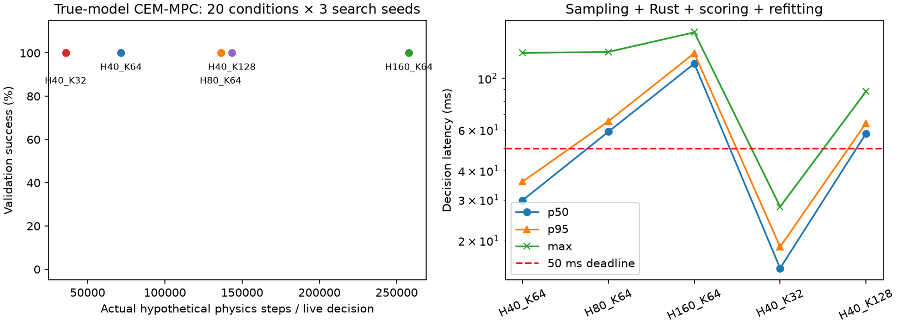
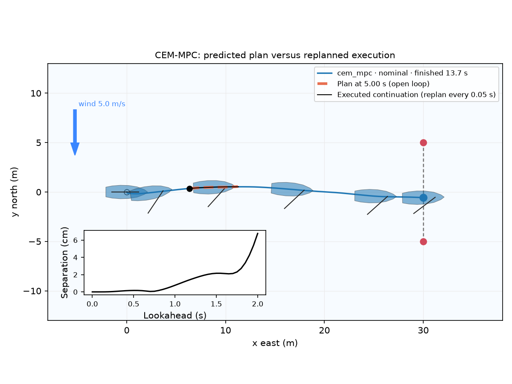

# M3 — True-model CEM-MPC

**Complete, 2026-11-13.** All five settings finished all 60 validation episodes.
The validation-selected default is **H=40, K=32, I=3**: 60/60 finishes,
15.2 ms median / 18.8 ms p95 decision latency and no deadline misses in the
sweep. Separate probes did show latency outliers; this is not a hard
real-time guarantee. See the saved [results](M3_results.json) and
[default freeze](../../experiments/ese3990/configs/M3_freeze.json).

## Implementation and course explanation

[`mpc.py`](../../experiments/ese3990/mpc.py) is the whole search/controller.
It implements the project plan's §4.3 and §4.5 settings, without neural
dynamics, a terminal critic or an expert sailing script.

The [advanced slides, PDF p. 120](ESE3990_slides_L14-L19_advanced_topics.pdf#page=120)
motivate sampling, ranking and adapting the proposal distribution. Here CEM
samples a diagonal Gaussian over **rudder/sheet rates per 0.5 s block**,
clips proposals to [−1,1], evaluates them and refits each coordinate to the
elite mean and population standard deviation. There are
`max(2, ceil(K/8))` elites. The initial standard deviation is 0.6; its floor is
0.1. Standard deviation resets to 0.6 at each live decision. The best sampled
candidate across all three iterations supplies the plan; candidate zero in
each iteration is the current mean. There is no extra rollout for display.
At H=40 there are four blocks/eight search coordinates; H=80/160 gives
16/32 coordinates. Live control still runs at 20 Hz.

Each candidate uses exact isolated Rust episode branches, the existing step
path and the common `TaskEnv.rollout` reward/action adapter. Its score is

\[
J=\sum_{t=0}^{H-1}0.999^t r_t,\qquad V_\text{tail}=0.
\]

Rust decides completion, capsize, bounds, mark misses and truncation. Candidate
rollouts stop at that outcome or the live episode's remaining physics budget.
The last decision can execute fewer than ten physics steps. Post-terminal
rows have zero steps/reward and are excluded from the work count. Truncation
has no failure penalty. All candidate/live actions force release off, exactly
as PPO/SAC do. No reward, task or physics equation changed.

The [advanced slides, PDF pp. 199–200](ESE3990_slides_L14-L19_advanced_topics.pdf#page=199)
explain receding-horizon control: execute only the first rate pair and plan
again from the observed next episode state. The warm start follows
[PDF p. 201](ESE3990_slides_L14-L19_advanced_topics.pdf#page=201): shift the
previous expanded sequence by **one decision**, repeat its tail, and average
each new block to restore the blocked parameterization. A new episode resets
the plan and search RNG. The slides provide this mechanism's motivation;
the specific blocking, clipping, variance floor and elite moments are our
declared implementation choices.

Independent candidates now run on the existing Rayon pool through
`Episode::for_each_fork`. Fork creation is serial because episodes are Send
but their sensors need not be Sync. Each worker owns a branch and disjoint
output slices. Physics stepping within one boat remains sequential. Rayon
stays in `sailgym-env`, respecting the existing dependency rule.

## Correctness evidence

- Hand-calculated elite ranking/means/population standard deviations/floor,
  stable tie handling and a discounted-ranking example.
- Warm-start shift by one decision followed by projection to block means;
  plan and RNG reset at each episode boundary.
- Same seed reproduces closed-loop actions/final-state checksum; hypothetical
  rollouts leave the live episode unchanged.
- One versus four Rayon threads returns bit-identical states, outcomes,
  durations and rewards. Existing branch-versus-replay proofs cover pending
  capsize history, gate passage, candidate order and the remaining budget.
- A 23-physics-step episode ends after decisions of 10, 10 and 3 steps, never
  resets inside a plan, and counts only actual hypothetical steps. Stored
  probe plans predict the next live position exactly, then pad with NaNs
  after the candidate ends. Release remains off in every research state.
- The cost report checks strict `latency > 50 ms` misses and hand-calculated
  percentiles. Malformed/nonfinite candidates and inconsistent block/cadence
  settings are rejected.

Verification: the complete experiment suite **79 passed** (61 existing +
18 MPC checks), Python Gym wrapper checks **31 passed**; Rust environment
tests **62 passed** (43 unit + 19 integration), including six fork proofs.
Ruff, cargo fmt and binding Clippy passed. A cached debug build initially
reported a dirty model identity; rebuilding the debug artifact made its
identity check pass. No physics source edit was needed.

## Validation protocol and cost units

The bounded E2 sweep is exactly five settings: H=40/80/160 at K=64, plus
K=32/128 at H=40, all with I=3 and 0.5 s blocks. Each uses the same 20 frozen
validation documents and search seeds **[0,1,2]**: 300 episodes total, with
live environment seed 0. Search randomness resets for each condition, so
the results do not depend on manifest order. These are optimizer repetitions,
not training seeds or independent learned policies. Test and shift documents
remain unopened by M3.

Before reading the sweep, selection was fixed to: most validation finishes,
then lower pooled p50 online latency, then setting name. The selected validation
score is a selection score, not held-out performance. There is no full K×H
cross product and no reward/terminal-value tuning.

`decision_latency_s` times the entire controller `act`: sampling, native
forks/rollouts, array transfer/allocation, shared Python reward/scoring, elite
refitting and action selection. It excludes live environment stepping and
episode-store I/O. Quantiles pool all realized decisions per setting; the
first call includes Rayon startup. Actual hypothetical physics steps stop at
candidate outcomes, so nominal `K × I × H × cadence` overstates the work near
terminal states. Report live interaction, candidate rollouts, native calls
and wall time separately; none is policy-training experience.

The measurement uses an AMD Ryzen AI 9 HX 370 and **12 Rayon threads**, one
study process. Some early baseline episodes overlap the brief verification
jobs; these are host-load measurements, not reserved-core latency guarantees.

## Measured sweep and selected default

| H decisions (seconds) | K | Finishes | Mean finish time (s) | Actual hypothetical steps / live decision |
|---|---|---|---|---|
| 40 (2) | 64 | 60/60 | 13.93 | 71,661 |
| 80 (4) | 64 | 60/60 | 14.23 | 136,155 |
| 160 (8) | 64 | 60/60 | 15.86 | 257,979 |
| **40 (2)** | **32** | **60/60** | **13.95** | **35,843** |
| 40 (2) | 128 | 60/60 | 13.93 | 143,406 |

| H | K | p50 / p95 / max latency (ms) | Decisions >50 ms | Miss rate |
|---|---|---|---|---|
| 40 | 64 | 29.85 / 35.95 / 128.70 | 63 / 16,750 | 0.38% |
| 80 | 64 | 58.91 / 65.39 / 130.00 | 13,488 / 17,102 | 78.87% |
| 160 | 64 | 115.77 / 128.38 / 157.88 | 16,282 / 19,056 | 85.44% |
| **40** | **32** | **15.20 / 18.80 / 27.99** | **0 / 16,768** | **0%** |
| 40 | 128 | 57.84 / 64.14 / 87.74 | 14,378 / 16,740 | 85.89% |

Every search seed finished 20/20 conditions at every setting. All failures,
capsizes, misses, bounds exits and timeouts have count zero in this sweep.
Success is saturated on validation: longer horizons and larger populations
show no success benefit here. H=160 is also slower to finish on average;
its larger search dimension at fixed K/I is one possible contributor, not an
isolated causal result. The cheaper K=32 setting wins the predeclared tie
break; it retains four elites and all other conventions above.

The sweep used **86,416 real decisions**, **862,783 real physics steps** and
**11,446,537,750 hypothetical physics steps**, with 4,442.19 s (74.04 min)
summed episode wall time. All 300 saved episodes replay exactly: outcome,
executed steps, return and final-state checksum. That audit adds 86,416 replay
decisions / 862,783 physics steps and took 4.91 s; replay is bookkeeping work,
not learner experience. Raw actions, per-decision latencies and provenance
remain in `runs/ese3990/mpc/M3/`. Compact evidence is in [M3_results.json](M3_results.json).

## Selected probes and predicted versus executed paths

The selected planner, search seed 0, finished nominal plus all five validation
probes. All six stored episodes replay exactly. All **1,628** recorded
first-step position predictions match live execution exactly (maximum error
**0 m**). The nominal finish is **13.71 s**; a fresh invocation through the
frozen-default evaluator reproduces its return **10.70592214789869** exactly.

The figure uses the nominal plan at the preselected time 5 s. At course scale
the planned and executed paths nearly overlap, so the inset shows separation
in centimetres: it reaches 6.77 cm after 2 s. After the first action, the
controller replans with new controls; that later separation is **not a model
prediction error under identical actions**.

The six probes add **1,628 real decisions**, **58,261,701 hypothetical physics
steps** and 21.14 s episode wall time. Their latency p50/p95/max is
12.79/17.12/79.98 ms, with **3/1,628 decisions above 50 ms**: nominal's first
call (60.59 ms) and two later decisions on validation-002 (79.98/52.63 ms).
The fresh nominal evaluator adds 275 decisions / 9,831,993 hypothetical steps
and one startup deadline miss (61.75 ms). Finite observed tail latency and
unisolated host load prevent a hard real-time claim, even though the default's
full sweep had no deadline misses. No warmup calls were discarded.

## Disclosed additional diagnostic cost

The initial run accidentally used standard deviation 1.0 and floor 0.05.
It was stopped when the mismatch with §4.5 was found, and the sweep restarted
with the planned **0.6/0.1**. This was a correction to the written settings,
not selection by outcome. The partial run is retained at
`runs/ese3990/mpc/M3_initial_std1`: **28 completed episodes, 7,821 live
decisions, 561,531,253 hypothetical physics steps and 216.153 s summed episode
wall time** (28 finishes). One additional in-flight episode was interrupted
and has no complete counters. These costs are additional to the required
sweep and are excluded from default selection.

These are completed-episode costs. The interrupted episode, initial
five-decision timing probe and implementation checks are outside those
totals; the extra diagnostic resource count is therefore a lower bound.

The release module preserves the existing M0–M2 episode-store model identity
(`701e3b17…`, marked dirty when M0 was built). This is stale baked-in build
metadata: the source diff to the committed physics tree (`4eee6597…`) consists
of M0's Clone implementation, pending-capsize accessor, comments and tests,
with no equation changes. M3's freeze records both the actual reported build
identity and relevant source hashes; it does not silently relabel a build.
A future build with a different identity is correctly refused by exact replay.

## Reproduction and remaining scope

See the [experiment README](../../experiments/ese3990/README.md) for extension
build, test, full sweep, probe and figure commands. Use
`uv run --frozen --no-sync` to preserve the installed extension. Full sweep
episodes and probe plans live in gitignored stores; compact summaries and
figures are the checked-in evidence.

Final test/shift comparison, learner outcome tables and presentation work
remain M4/M5. This is known-model planning with exact simulator access,
not a zero-sample learner or a guaranteed performance upper bound.
