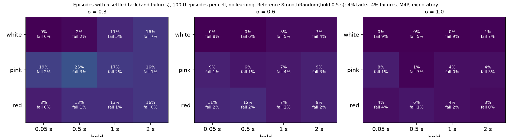

# M4P — Exploration probe: can undirected noise find a tack? (exploratory)

**Complete, 2026-11-17.** No learning. Random rate noise drove task U (one gate
40 m dead upwind, 180 s, 20 Hz) in 37 cells of 100 episodes each, 3,700 in
all. Every episode is stored, and all 3,700 replay exactly. Every row is
post-hoc and exploratory, and none is merged into an M4/M4U/M4X table.

**Reading:** the declared reading "white at 0.05 s does not reach, but a
correlated or held process does" applies. Per-decision white noise, the kind
the learners explore with, never tacks at any scale. 11 of 37 cells reach the
threshold, tacking in 11–25% of episodes with at most 7% failures:

- pink noise at σ = 0.3, at every hold;
- red noise at σ = 0.3 with holds ≥ 0.5 s, and at σ = 0.6 with holds ≤ 0.5 s;
- white noise at σ = 0.3 held for 1–2 s.

**But tacking is not beating.**

- No cell makes real upwind progress: mean max y ≤ 5.6 m of 40, and at most
  2% of episodes reach y = 20 m.
- No episode finishes, 0 of 3,700.

Random exploration can supply the manoeuvre, but not the sequence of tacks and
progress that finishing needs.

## Protocol

- **Freeze:**
  [`configs/M4P_freeze.json`](../../experiments/ese3990/configs/M4P_freeze.json),
  written 2026-11-17 at 03:05:26 UTC, before any probe episode. It records the
  37 cells, the condition IDs, the seed rule, the threshold, the readings, the
  diagnostics-threshold hash, the SHA-256 of 8 sources (`probe.py` refuses to
  run if any changed) and the build identity.
- **Controller:**
  - Rates are σ · noise, clipped to [−1, 1].
  - Each noise realisation has a power spectrum ∝ 1/f^β, one per episode and
    action dimension. β = 0 is white, 1 pink, 2 red, generated by spectral
    shaping (Timmer & König 1995).
  - The noise is sampled once per hold and held.
- **Grid:** 3 colours × 4 holds (0.05, 0.5, 1, 2 s) × 3 scales (σ = 0.3, 0.6,
  1.0), plus a reference cell: M1's calibration controller,
  `SmoothRandom(hold=10)`, with uniform rates held for 0.5 s.
- **Conditions:** the same 100 training conditions in every cell
  (`TrainingSampler(100)`, disjoint from validation, test and shift), so cells
  are paired. The environment seed is the episode index. Each episode has its
  own controller seed, 10⁶·100 + 10³·cell + episode.
- **Measures:** settled tacks come from `u_diagnostics` with the frozen M4U
  thresholds, on an exact replay of every episode.
- **Threshold, declared before results:** a process *reaches* if ≥ 10% of its
  episodes contain a settled tack and ≤ 10% fail (out of bounds, capsize or
  mark missed). With 100 episodes, the binomial standard error near 10% is
  about 3 points, so cells at 11–13% are within noise of the threshold.
- **Cost:** the grid took 85 s on 12 cores, at about 28,000 decisions per
  second per process. The replay audit and the diagnostics replay took 78 s
  and 82 s.

**Zero-cost first look.** The 9 calibration episodes the M4U learners started
from (`SmoothRandom(hold=10)`, 10,000 decisions per training seed) contain no
tack, no failure and no time in irons. Their mean max y is 4.5 m, and the
timeouts end 62–118 m from the gate.

## Results

The cells below show the share of episodes with a settled tack / the share
ending in a failure. **Bold** cells reach the threshold.

| σ = 0.3 | 0.05 s | 0.5 s | 1 s | 2 s |
|---|---|---|---|---|
| white | 0 / 6 | 2 / 2 | **11 / 5** | **16 / 7** |
| pink | **19 / 2** | **25 / 3** | **17 / 2** | **16 / 1** |
| red | 8 / 0 | **13 / 1** | **13 / 1** | **16 / 0** |

| σ = 0.6 | 0.05 s | 0.5 s | 1 s | 2 s |
|---|---|---|---|---|
| white | 0 / 8 | 0 / 6 | 3 / 5 | 3 / 4 |
| pink | 9 / 1 | 6 / 1 | 7 / 4 | 9 / 3 |
| red | **11 / 2** | **12 / 2** | 7 / 2 | 9 / 2 |

| σ = 1.0 | 0.05 s | 0.5 s | 1 s | 2 s |
|---|---|---|---|---|
| white | 0 / 9 | 0 / 5 | 0 / 9 | 1 / 7 |
| pink | 8 / 1 | 1 / 7 | 4 / 0 | 4 / 3 |
| red | 4 / 4 | 6 / 1 | 4 / 2 | 3 / 0 |

The reference cell, `SmoothRandom` (uniform, 0.5 s hold), scores 4 / 4.

- **White noise at every decision never tacks and never gains ground.** It
  gets 0 tacks in 300 episodes over the three scales. Its mean max y is
  0.0 m at σ = 0.3 and 0.6, and 0.003 m at σ = 1.0: the boat essentially never
  gets upwind of its start.
- **Colour matters more than hold.** Pink noise with no hold already reaches
  19%. White noise needs a 1–2 s hold at σ = 0.3 to reach 11–16%.
- **Smaller scales tack more.** No σ = 1.0 cell reaches the threshold. By
  inference, large rate noise saturates the rudder and sheet, which makes the
  boat spin or stall rather than turn through the wind and settle.
- **Failures stay low everywhere,** at 0–9%. All 122 failures are out of
  bounds; there are no capsizes or mark misses. No cell tacks only at the cost
  of failures.
- **No upwind progress anywhere.** Across all 37 cells, mean max y is 0.0–5.6 m
  and the share of episodes reaching y ≥ 20 m is 0–2%. Timeouts end 91–100 of
  every 100 episodes in every cell. There are no finishes.

Full per-cell numbers are in [`M4P_results.json`](M4P_results.json): tacks,
failed tacks, gybes, irons, sternway, max y, outcomes and timeout distances.
The replay audit is [`M4P_replay_audit.json`](M4P_replay_audit.json): 3,700
exact replays, 13.3M decisions, no failures.

## Which declared reading applies

| Observation (declared) | Applies? | Evidence |
|---|---|---|
| White noise at a 0.05 s hold already reaches → noise is not U's bottleneck | **No** | 0/100 tacks at every σ |
| White at 0.05 s does not reach, but a correlated or held process does → per-decision white noise is a cause; that process is the next RL arm's exploration setting | **Yes** | 11 cells reach. Best: pink noise, 0.5 s hold, σ = 0.3, with 25% tacks and 3% failures. Without a hold: pink at σ = 0.3 gets 19 / 2 |
| Tacks appear only with > 10% failures → curricula or resets first | **No** | No cell has ≥ 10% tacks with > 10% failures |
| No cell reaches 10% tacks → reset-based discovery next | **No** | 11 cells reach |
| Any random finish → report its rate | **None** | 0 finishes in 3,700 episodes |

**What this means for the next RL arm, after Dec 3** (inference). The
exploration process should be correlated: pink noise at a small scale,
optionally with 0.5 s holds. That removes one cause, because the learners'
white per-decision noise never even produces the manoeuvre. It does not remove
the other. Random exploration reaches the tack but not the beat: no cell makes
upwind progress, and none finishes. A learner would therefore start from zero
finishes, with only the dense shaping signal to connect tacks into progress.
This matches M4U, where PPO tacked in 40/150 test episodes but got at most
8.2 m upwind. Pairing correlated noise with a start-state curriculum, or with
the critic and decision-interval fixes, is still needed to reach a finish.

## Deviations and limitations

- **Start gate.** M4P's gate (M4X's report done, its held-out stage off the
  CPU) was met by closing M4X early by user decision. See the [M4X
  report](M4X_report.md#not-done-skipped-2026-11-17).
- **Pilot collision, fixed before any analysis.**
  - The one-cell timing pilot (`beta0_hold01_sigma0.3`) was detached with
    `setsid`, and the full grid started while it was still writing its last
    episodes.
  - Both processes appended to that cell, leaving 109 index entries over 100
    shards.
  - The cell was deleted and rerun alone before the audit. Episode seeds are
    fixed per (cell, episode), so the rerun reproduces exactly what an
    uninterrupted run would have drawn.
  - No other cell was affected: each had exactly 100 episodes. The audit is
    clean.
- **Random processes are not a learner's exploration after training starts.**
  A policy's noise interacts with what it has learned. M4P measures only the
  starting point and what different noise processes can reach on their own.
- **Measurement limits.** Tack counts depend on the frozen M4U diagnostics
  thresholds. The rates are clipped, so at σ = 1.0 about a third of samples
  sit at ±1. There are 100 episodes per cell, with no confidence intervals
  across cells.
- **Cosmetic.** The figure's "hold" axis label is slightly clipped. `probe.py`
  is hash-frozen, so the figure code was not changed.
