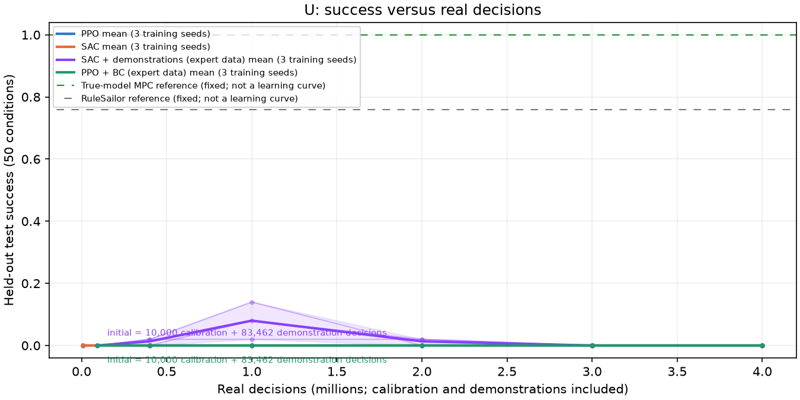

# M4U — Upwind comparison with an expert-data arm

**Complete, 2026-11-17.** Task U (one upwind gate at (0, 40), 180 s, contract 2:
γ = 0.99975) was run from scratch for PPO and SAC, with two labeled
expert-data arms (SAC + demonstrations, PPO + BC) and BC only, plus the
validation-selected true-model MPC and RuleSailor. **5,396 held-out episodes**
were stored, and every one replays exactly. No controller, reward, task,
threshold or selection rule was changed after test/shift outcomes were opened.
R's freezes, rows and stores are untouched: all 2,840 M4 episodes still replay
exactly under the amended contract. M4X follows as a separate, post-hoc and
exploratory milestone. Nothing in this report depends on it.

## Frozen protocol

Settings were frozen before any U learning run, in
[`M4U_train_freeze.json`](../../experiments/ese3990/configs/M4U_train_freeze.json):
γ = 0.99975, 4M decisions per run (calibration and demonstrations included),
400k SAC replay, checkpoints at initial/400k/1M/2M/3M/4M, everything else as in
the M2 freeze. The planner was selected on validation only
([`M4U_mpc_freeze.json`](../../experiments/ese3990/configs/M4U_mpc_freeze.json)).
The held-out freeze (`runs/ese3990/M4U/heldout/freeze.json`) records 144
checkpoint-file hashes, both freeze files, the diagnostics thresholds
([`M4U_diagnostics.json`](../../experiments/ese3990/configs/M4U_diagnostics.json),
frozen before held-out results), the condition-manifest hashes and the evaluator
hash. It was written before test/shift were opened. The report generator
re-verifies all of them: frozen hashes unchanged, 5,396/5,396 expected
episodes, no unreported store entries, and all 72 nominal checkpoint reloads
match.

**Demonstrations (expert data).** These are 50 RuleSailor episodes on
`TrainingSampler(1000)` conditions, drawn from the training distribution with
no held-out documents. The store has sha256 `69575c91…` and holds D = 83,462
decisions: 37 finished, 7 mark missed, 6 truncated. Every outcome is kept. Each
expert-data run is charged D against its 4M budget. RuleSailor's tack recipe
(a 1,344-script sweep) is uncounted human prior work.

| Arm | Seed 0 selected | Seed 1 selected | Seed 2 selected | Selected validation finishes |
|---|---|---|---|---|
| PPO | 3,000,080 | 4,000,000 | 1,001,232 | 0, 0, 0 /20 |
| SAC | 4,000,000 | 4,000,000 | 400,000 | 0, 0, 0 /20 |
| SAC + demonstrations (expert data) | 1,000,000 | 400,000 | 2,000,000 | 7, 1, 0 /20 |
| PPO + BC (expert data) | 4,000,000 | 3,001,622 | 2,000,150 | 0, 0, 0 /20 |

The rule is unchanged from M4: the most validation finishes, then the greatest
validation mean return, then the earliest checkpoint. With zero finishes, the
return tie-break decides. BC only is PPO + BC's initial checkpoint (93,462
decisions: 10k calibration + D). It is behaviour cloning plus value
pretraining, with no PPO update. Its actor loss fell from 1.22–1.27 to
0.221–0.225 (pre-squash MSE) over the 20 epochs
(`runs/ese3990/M4U/main/ppo_bc_U_s*/bc.jsonl`). The
[main-run audit](M4U_main_audit.json) verifies exact budgets, finite metrics,
curve rows against the episode index, probe replay and nominal reload for all
12 runs.

Each learner arm has **three training seeds**. MPC has **three optimizer/search
seeds**, and RuleSailor is one engineering reference. Fifty test and twenty
shift conditions are reused across repetitions. These numbers compare
implemented systems; they are not an information-matched ablation. MPC has an
exact model and episode branches, and RuleSailor has its own sensors and
maneuver memory.

## Outcomes

| Controller / role | Test finishes | Per repetition (of 50) | Shift finishes | Per repetition (of 20) |
|---|---|---|---|---|
| PPO, selected | 0/150 | 0, 0, 0 | 0/60 | 0, 0, 0 |
| PPO, final | 0/150 | 0, 0, 0 | 0/60 | 0, 0, 0 |
| SAC, selected | 0/150 | 0, 0, 0 | 0/60 | 0, 0, 0 |
| SAC, final | 0/150 | 0, 0, 0 | 0/60 | 0, 0, 0 |
| SAC + demonstrations (expert data), selected | **5/150** | 4, 1, 0 | 0/60 | 0, 0, 0 |
| SAC + demonstrations (expert data), final | 0/150 | 0, 0, 0 | 0/60 | 0, 0, 0 |
| PPO + BC (expert data), selected | 0/150 | 0, 0, 0 | 0/60 | 0, 0, 0 |
| PPO + BC (expert data), final | 0/150 | 0, 0, 0 | 0/60 | 0, 0, 0 |
| BC only (expert data) | 0/150 | 0, 0, 0 | 0/60 | 0, 0, 0 |
| True-model MPC H=160, frozen (offline) | **150/150** | 50, 50, 50 | **60/60** | 20, 20, 20 |
| RuleSailor, reference | 38/50 | 38 | 2/20 | 2 |

Failures are never dropped. Full counts are in the [outcome table](M4U_outcomes.md)
and the [machine-readable results](M4U_results.json). The selected learners'
test failures:

- PPO: 144 timeouts, 4 out of bounds, 2 mark misses.
- SAC: 150 timeouts.
- SAC + demonstrations: 98 timeouts, 45 mark misses, 2 out of bounds.
- PPO + BC: 150 timeouts.
- BC only: 124 timeouts, 25 out of bounds, 1 mark miss.

RuleSailor's test failures are 8 mark misses and 4 timeouts. Its shift failures
are 8 mark misses and 10 timeouts. MPC has no failures. On nominal, only MPC
(3/3) and RuleSailor (1/1) finish.

Conditional finish times count only successful episodes and are never
averaged over failures:

| Controller | Test mean (range), s | Shift mean, s |
|---|---|---|
| MPC | 48.00 (43.89–53.70) | 51.40 |
| RuleSailor | 71.53 (51.75–179.14) | 105.59 (2 finishes) |
| SAC + demonstrations | 68.55 (51.76–78.12), 5 finishes | — |

These successful subsets differ, so the means are not a paired comparison.

Among all predeclared checkpoints, rather than the selected and final views
above, SAC + demonstrations has 18 finishes in total. Seed 2's 1M checkpoint
finishes 7/50 test and nominal. Its validation score was 0/20 at every
checkpoint, so the frozen rule selected 2M. That selection is kept, not
repaired using the held-out observation.

## Behaviour diagnostics (exact replay, frozen thresholds)

`u_diagnostics.py` runs on every held-out episode with the frozen thresholds:
head to wind |TWA| < 30°, steerage way u ≥ 0.1 m/s, and a 2 s settle. A
**tack** crosses head to wind once, net, between two settled spells. The full
table, with final and nominal rows, is [M4U_diagnostics.md](M4U_diagnostics.md).

| Selected controller (test, 150 or 50) | Episodes with a tack | Mean failed tacks | Mean irons (s) | Mark missed | Out of bounds | Timeouts | Timeout final distance, median (m) | Mean max y (m) |
|---|---|---|---|---|---|---|---|---|
| PPO | 40/150 | 0.12 | 5.5 | 2 | 4 | 144 | 66.3 | 8.2 |
| SAC | 0/150 | 0.00 | 0.5 | 0 | 0 | 150 | 57.0 | 3.8 |
| SAC + demonstrations | 81/150 | 0.04 | 3.7 | 45 | 2 | 98 | 62.6 | 24.5 |
| PPO + BC | 20/150 | 0.00 | 3.7 | 0 | 0 | 150 | 69.4 | 5.6 |
| BC only | 0/150 | 0.00 | 0.0 | 1 | 25 | 124 | 123.5 | 0.4 |
| MPC H=160 | 130/150 | 0.13 | 0.0 | 0 | 0 | 0 | — | 40.0 |
| RuleSailor | 49/50 | 0.22 | 5.9 | 8 | 0 | 4 | 37.0 | 38.8 |

Over all selected held-out episodes (nominal + test + shift, 213 per learner
arm), SAC + demonstrations tacks in 87, PPO in 49, PPO + BC in 22, SAC in 1 and
BC only in none. The start is 40 m from the gate centre. The selected
from-scratch learners' timeouts end a median 57–71 m away, and their mean
furthest upwind progress is 1.6–8.2 m of 40. These learners mostly run out the
clock near the start line rather than fail by capsize or miss. BC only drifts
furthest (median 107–124 m) and leaves the area most often. SAC +
demonstrations gets furthest upwind among the learners (test mean max y
24.5 m), but trades timeouts for 45 mark misses.

**Planner horizon.** The same diagnostics on the M4U validation sweep
([M4U_mpc_sweep_diagnostics.json](M4U_mpc_sweep_diagnostics.json)) show a
sharp difference. At H=40 (2 s) MPC never tacks or even attempts one: 0/60
episodes with a tack and 0 failed tacks. Its mean max y is 12.5–13.1 m, and its
59 timeouts end a median 65–74 m from the gate. At H=160 (8 s), 51/60
validation episodes have a counted tack and all 60 finish.

**Diagnostic limitation.** Twenty of MPC's 150 test finishes (and 1 of 60
shift) record zero tacks and one failed tack. In each, the boat crosses head to
wind and returns to its starting side without a 2 s spell at |TWA| ≥ 30° with
way on in between, so the frozen classifier cannot call it a tack. These boats
still pass the gate, so the tack column understates MPC's maneuvers. The
thresholds were set from RuleSailor's beats at |TWA| 45–47°. They are kept
unchanged and were not re-tuned on held-out data.

RuleSailor degrades on the shift set (4/6 m/s, heading offsets up to ±30°): 2/20
finishes, 0.95 failed tacks and 40.9 s in irons per episode, and 44.4 s of
sternway. The test set is within its training-like range: 38/50, with 1.96 tacks
per episode.

## Learning curves

The figure plots held-out test success at every predeclared checkpoint, against
real decisions, with calibration and demonstrations included. MPC and
RuleSailor are drawn as fixed reference levels, not learning curves. PPO, SAC
and PPO + BC are 0/50 at every checkpoint and every seed. SAC + demonstrations
rises to a mean of 0.08 at 1M (4, 1 and 7 of 50 by seed). It then falls to 0 by
3M on every seed, and its final checkpoints finish nothing. Validation tells the
same story for seed 0: 7/20 at 1M, then 0/20 from 2M on. The expert-data
initial checkpoints start at 93,462 decisions, which the figure annotates.

## Cost and resources

- **Training:** 12 runs × 4M = **48M real decisions**, comprising 120k
  calibration decisions, 500,772 demonstration decisions charged to the six
  expert-data runs, and 47,379,228 training decisions. Validation and probe
  evaluation during training added 3,729,461 and 1,496,609 decisions. The
  audit added 68,864 actor-evaluation and 416,693 replay decisions. Recorded
  wall time per run was about 1,080–1,095 s for PPO and PPO + BC, and about
  11,615–11,677 s for SAC and SAC + demonstrations. All 12 ran concurrently with
  the MPC validation sweep on 12 physical cores. These are process wall times
  under contention, not CPU time and not a runtime law.
- **MPC validation sweep:** H=40 used 8.25B and H=160 8.37B hypothetical
  physics steps over 60 episodes each. H=40 took 47.8 / 82.4 / 152.9 ms
  p50/p95/max per decision, with 94,314 of 215,968 decisions over 50 ms. H=160
  took 193.3 / 298.0 / 530.5 ms, with 55,877 of 57,980 over 50 ms. Selection
  was predeclared (most finishes, then lower p50), so H=160 was selected and is
  **labeled offline / non-real-time**. All six planned-path probes have 0.0 m
  first-step prediction error
  ([cost figure](figs/M4U_mpc_cost.png), [prediction figure](figs/M4U_mpc_prediction.png)).
- **Held-out evaluation:** 5,396 episodes, **18,126,999 real decisions**,
  181,265,745 physics steps and **30,153,993,831 hypothetical MPC physics
  steps**. Summed episode wall time was 34,597 s, run with 6 jobs at
  RAYON_NUM_THREADS = 6.
- **Online latency, selected test rows:**
  - MPC: 147.0 / 210.7 / 388.8 ms p50/p95/max; 138,088 of 144,073 decisions
    over 50 ms; first call 314 ms.
  - Learners: about 0.06 ms p50 and under 11 ms max; none over 50 ms.
  - RuleSailor: 0.0013 ms p50.
- **Exact replay:** [all 5,396 held-out episodes](M4U_replay_audit.json)
  reproduce outcome, physics steps, return and final checksum. The audit took
  73.5 s on 24 processes. The [R check](M4U_R_replay_check.json) replays
  2,840 M4 episodes plus 42 viz_demo episodes (21 U, contract 1); all 2,882 are
  exact. Replay is bookkeeping, not experience.

MPC's test peak heel reaches 50.1° (mean per-episode peak 40.3°), against
RuleSailor's 38.9° (34.9°). Decision-sampled rudder/sheet travel is 10.40 rad
and 7.54 m for MPC, and 10.17 rad and 11.68 m for RuleSailor. MPC finishes about
23 s sooner on test with more heel.

## Which declared reading applies

The readings below were declared in the plan (§6, M4U) before any result. Each
is checked against the evidence above.

| Observation (declared) | Applies? | Evidence |
|---|---|---|
| SAC + demonstrations ≫ SAC from scratch → the bottleneck was *discovering* the tack | **In part.** It holds for tacking, not for finishing | Tacks in 87/213 selected held-out episodes versus 1/213; test mean max y 24.5 m versus 3.8 m. Finishes are only 5/150 versus 0/150, with 45 mark misses and 98 timeouts. Discovering the tack was *a* bottleneck, and demonstrations removed much of it, but reaching the gate remained unsolved. The skill also decayed after 1M (final 0/150) |
| SAC + demonstrations > RuleSailor → RL improved on its expert | **No** | 5/150 versus 38/50 test; 0/60 versus 2/20 shift. SAC + demonstrations has 45 mark misses in 150 episodes, against RuleSailor's 8 in 50, so it did not remove RuleSailor's misses |
| PPO + BC ≪ SAC + demonstrations → off-policy learning keeps using expert data; on-policy cannot | **Directionally, on tacking; weakly on finishes** | PPO + BC 0/150 versus 5/150 test; tacks in 22/213 versus 87/213. PPO + BC tacks less than PPO from scratch (49/213). SAC + demonstrations did not *keep* the benefit: it fell to 0/150 by its final checkpoint despite the never-evicted demonstration buffer. One BC protocol was tested, so this is not a general on-policy limit |
| BC only < RuleSailor → compounding error, or averaging over RuleSailor's hidden mode | **Yes** (the mechanism is not isolated) | 0/150 versus 38/50; no tacks; 25/150 out of bounds; timeouts end a median 123.5 m away. The [mode check](M4U_mode_check.json) recovers the hidden mode from the 17 features (0.82 balanced accuracy, versus 0.38 linear and 0.14 majority), which weighs against the hidden-mode explanation. Compounding error is consistent with the result but not demonstrated |
| MPC H=40 fails, H=160 succeeds → planning is horizon-bound; a value tail is the next step | **Yes** | Validation: H=40 0/60, with no tack and no tack attempt; H=160 60/60. Held-out H=160: 150/150 test, 60/60 shift, 3/3 nominal, but offline at 147 ms p50. With the same K = 32 and I = 3, the longer horizon alone recovers the tack, so the 2 s planner is not search-bound here |
| Both MPC settings fail → search-bound | **No** | H=160 finishes every episode |
| Every arm fails, including the expert-data arms | **No** as stated; **yes** for the learners | MPC and RuleSailor finish. Every learner row is 0/150 except SAC + demonstrations' 5/150. Reported with the tack/irons diagnostics; no hidden tack script was added |

**Answers to M4U's three questions.**

1. **R's ranking survives only at the top.** On R, SAC beat PPO (117/150
   against 0/150). On U from scratch, both are 0/150. MPC (exact model,
   offline) finishes 100%, and RuleSailor stays in between at 76% test.
2. **Tack discovery is a learner bottleneck, but not the only one.**
   Demonstrations make SAC tack. They do not make it finish reliably, and the
   gain does not last.
3. **MPC is horizon-bound on U**, at about 3–4× the 50 ms real-time budget
   (147 ms p50 held-out, 193 ms in the validation sweep): a 2 s horizon never
   tacks, while an 8 s horizon always finishes.

The learners' dominant failure is the timeout: they stay near the start until
the clock runs out. This is consistent with PPO's R behaviour (M1 §4), but its
cause is not isolated here.

## Media

[Video specs](M4U_videos.json) define 16 exact-replay overlays from stored
held-out episodes only:

- the nominal controller comparison (7 boats, with control traces);
- checkpoints and selected seeds for each learner arm;
- MPC optimizer repetitions;
- the first failure by condition ID for each controller. Every first failure is
  `shift-000` (4 m/s from 3.86°, heading 113.63°). MPC has no failure, and none
  is invented.

All 16 were rendered from stored episodes, with no new rollouts, in 8 min 7 s.
Each has a GIF and an MP4 with matching frame counts, plus a static grid;
outputs are in `runs/ese3990/M4U/heldout/videos/`. The
[media index](M4U_media.json) records the spec and renderer hashes, frame
counts and each episode's final checksum. Expert-data arms are labeled
`[expert data]` in every title and label.

## Scope and limitations

- No M4U arm is post-hoc: all settings, demonstrations, planner selection and
  diagnostics thresholds were frozen before held-out outcomes.
  M4X's arms are added after U validation outcomes were opened. They are
  labeled exploratory and are never merged into these tables.
- Three training seeds and one demonstration set support limited statistical
  claims. Condition repetitions are not independent training seeds.
- The selected U planner is offline. A real-time U planner is not supported by
  this evidence.
- Prior unequal resources, MPC's exact-model privilege and RuleSailor's
  uncounted hand tuning remain disclosed. The [claim index](M4U_claims.json)
  maps each artifact to its sources, freezes, seeds, commands and outputs, and
  lists the claims these results do not support.

**Checks.** The report generator verifies all frozen hashes, expected episode
counts, store completeness and 72 nominal reloads. Exact replay passes for
5,396 held-out and 2,882 R/viz_demo episodes. M4U closure changes no code.
