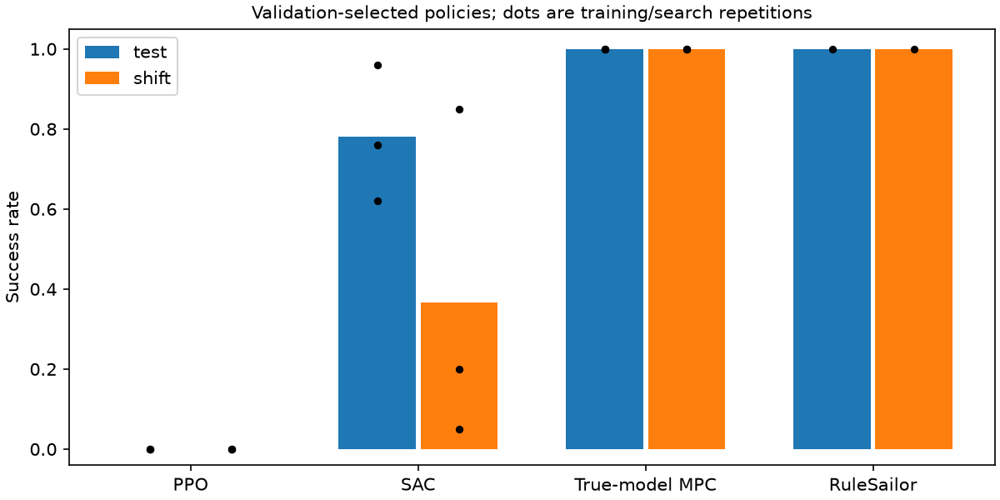
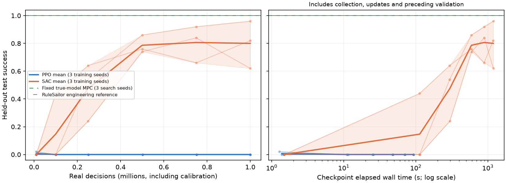
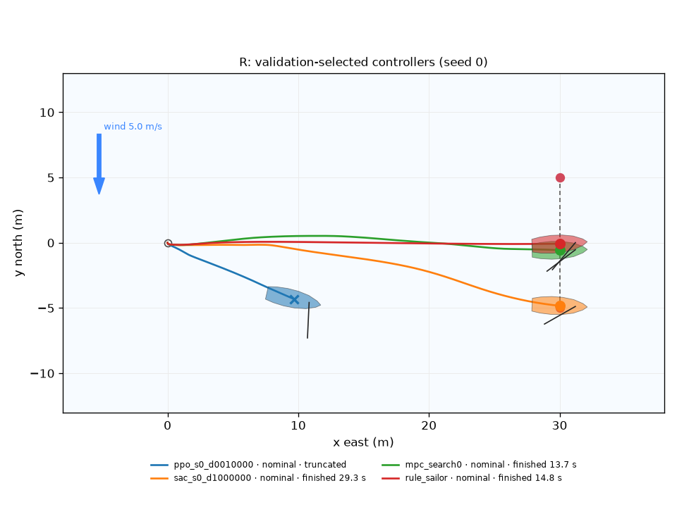
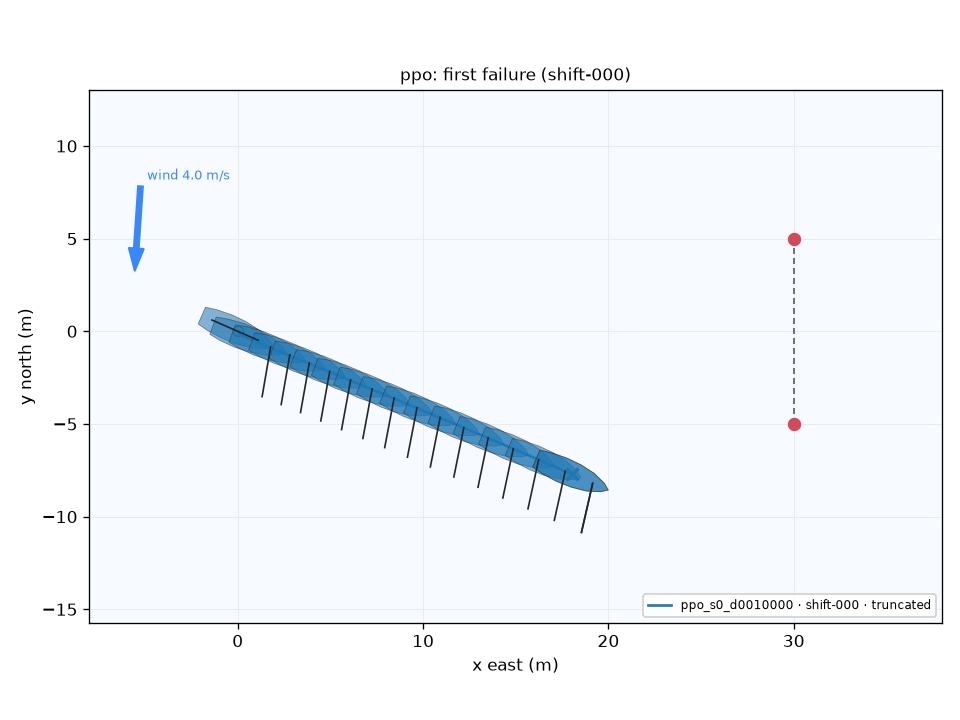
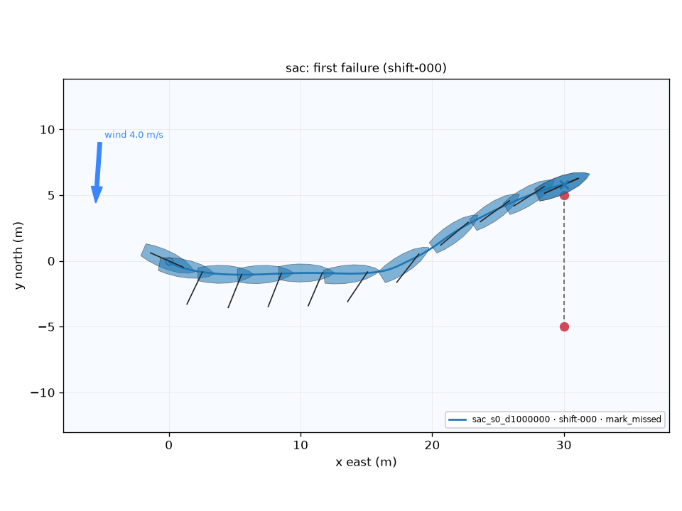

# M4 — Frozen reaching comparison and failure analysis

**Complete, 2026-11-13.** All six main learners finished their frozen 1M-decision
budgets. All predeclared checkpoints, selected MPC and RuleSailor were evaluated
on nominal, test and shifted R conditions: **2,840 stored episodes**, all exactly
replayed. No controller, reward, task or checkpoint-selection rule was tuned
after opening the held-out outcomes. Upwind remains deferred; presentation and
final packaging are M5.

## Frozen protocol

The [M4 freeze](../../experiments/ese3990/configs/M4_freeze.json) records 72
checkpoint-file hashes, all six saved checkpoints per learner/seed, the
validation-selected and final roles, condition-manifest hashes and common
build/contract identity. It was written before held-out outcomes were collected.
The [main-run audit](M4_main_audit.json) verifies every validation curve against
its episode index, finite optimization metrics, selected/final probe replay
and nominal checkpoint reload. All 36 checkpoints also reproduce their original
nominal return exactly during M4. Calibration actions, conditions, final-state
checksums and normalization match exactly between PPO/SAC for each paired seed.

| Learner | Training seed | Validation-selected decisions | Selected validation finishes |
|---|---|---|---|
| PPO | 0 | 10,000 | 0/20 |
| PPO | 1 | 501,520 | 0/20 |
| PPO | 2 | 751,376 | 0/20 |
| SAC | 0 | 1,000,000 | 16/20 |
| SAC | 1 | 1,000,000 | 17/20 |
| SAC | 2 | 500,000 | 18/20 |

PPO checkpoints occur at the next rollout boundary; use actual decisions on
plots. Seed-0 PPO's selected 10k actor is its initial actor, before gradient
updates: all checkpoints have zero validation finishes and the frozen tie break
prefers its return. Final checkpoints are reported too. Failed seeds are retained;
no successful pilot was promoted into the main comparison. PPO seed 0 had
already been inspected before the main freeze, as disclosed in M2.

Each learner has **three training seeds**, MPC has **three optimizer/search
seeds**, and RuleSailor is one engineering reference. Fifty test and twenty
shift conditions are reused across repetitions. Episodes/checkpoints are not
extra independent training seeds; three seeds support limited statistical
claims. MPC has an exact dynamics/episode model; RuleSailor has its existing
sensor inputs and maneuver memory. These are implemented-system comparisons,
not an information-matched algorithmic ablation.

## Outcomes

| Controller / role | Test finishes | Per repetition (of 50) | Shift finishes | Per repetition (of 20) |
|---|---|---|---|---|
| PPO, validation-selected | 0/150 | 0, 0, 0 | 0/60 | 0, 0, 0 |
| PPO, final | 0/150 | 0, 0, 0 | 0/60 | 0, 0, 0 |
| SAC, validation-selected | 117/150 | 31, 48, 38 | 22/60 | 4, 17, 1 |
| SAC, final | 120/150 | 31, 48, 41 | 28/60 | 4, 17, 7 |
| True-model MPC, frozen | 150/150 | 50, 50, 50 | 60/60 | 20, 20, 20 |
| RuleSailor, reference | 50/50 | 50 | 20/20 | 20 |

All three selected SAC policies finish nominal R; all three selected/final
PPO policies time out there. Full nominal results, conditional completion times,
failure counts, heel and sampled actuator travel are in the
[outcome table](M4_outcomes.md) and [machine-readable results](M4_results.json).
Selected SAC's test failures are 25 timeouts and 8 mark misses; its shifted
failures are 32 timeouts and 6 mark misses. Selected/final PPO failures are all
timeouts. MPC/RuleSailor have no failures on these sets. One capsize occurs
among the other predeclared checkpoint evaluations and is retained in the raw
results; there are no missing or discarded episodes.

Selected SAC averages **78% test / 36.7% shift** success, with substantial
training-seed variation. Its final checkpoint happens to perform better on
these held-out sets; the validation selection is preserved, not repaired using
that observation. The broader [PPO pilot history](../rl/ppo_tuning_log.md)
contains successful seeds, so these failed main seeds do not establish that
PPO cannot solve R. Unequal prior tuning resources also prevent an equal-tuning
cost or general algorithm-ranking claim.

## Learning and online computation

Faint lines show individual seeds; thick lines and shading show mean/range at
matched saved-budget indices, not confidence intervals. The time panel uses
each checkpoint's logged elapsed wall time, including calibration, compilation,
collection, optimization and preceding validation; the mean curve uses mean
time at each budget. Reference lines are fixed known-model/engineering outcomes,
not zero-sample learners at the origin. Both references finish 100% here, so
their dashed lines alternate at the same height.

Main PPO runs take 93–95 s and SAC runs 1,188–1,194 s each under the recorded CPU
setup. They were queued concurrently; their summed process wall time is
3,856.87 s, **not CPU time or serial queue elapsed time**. This is evidence
about these implementations/resources, not a general runtime theorem.

| Selected controller | Test act p50 / p95 / max (ms) | Test decisions >50 ms |
|---|---|---|
| PPO | 0.0224 / 0.0302 / 0.632 | 0/135,000 |
| SAC | 0.0243 / 0.0313 / 1.975 | 0/74,381 |
| True-model MPC | 14.34 / 18.79 / 30.31 | 0/42,003 |
| RuleSailor | 0.00061 / 0.00066 / 0.0186 | 0/15,924 |

`act()` includes controller features/inference or sampling, branch simulation,
transfer, reward scoring and elite fitting. It excludes live physics stepping,
the shared live action adapter and episode-store I/O. The adapter is separately
benchmarked with 10,000 calls per native input type, approximately **3 μs
median**; raw measurements are in the results. Those independent quantiles
must not be added as though jointly measured. Compiled functions and Rayon
are reused across the actual evaluation sequence; first observed calls are
recorded separately. MPC's first nominal call is **52.55 ms**, the only >50 ms
call in the full M4 evaluation. Neither these measurements nor M3's probe
outliers support a hard real-time guarantee.

The bounded horizon/budget study is unchanged from [M3](M3_report.md): all five
settings succeed on validation, but increasing lookahead/population costs more
without a success gain there. The [MPC cost figure](figs/M3_mpc_cost.png) and
[predicted-versus-executed figure](figs/M3_mpc_prediction.png) are reused, with
their original validation-selection scope. No final-set planner retuning occurred.

## Representative behavior and media

This deterministic selection shows PPO seed 0 drifting until timeout, SAC
seed 0 finishing near the lower gate edge in 29.3 s, and MPC/RuleSailor finishing
in 13.7/14.8 s. The selected-policy test conditional mean completion times are
20.35 s for SAC, 13.98 s for MPC and 15.90 s for RuleSailor. Failed attempts are
reported separately and never averaged into those completion times. SAC's
successful subset is different, so the means are not a paired minimum-time claim.

Representatives are selected by condition ID, then group ID, across the held-out
and shift sets. Both first failures are `shift-000`: 4 m/s wind from 3.86° and
initial heading 113.63°. PPO's selected seed-0 actor times out 14.22 m from the
gate centre; SAC's seed-0 actor reaches the gate line above its end and Rust
terminates it for a mark miss. These are observed failures; their mechanism
is not isolated by the single trajectories. There is no invented first failure
for MPC or RuleSailor. The [PPO](figs/M4_ppo_failure_controls.png) and
[SAC](figs/M4_sac_failure_controls.png) control traces accompany them.

MPC's test maximum heel is 31.0° versus RuleSailor's 22.5°. Mean rudder/sheet
travel is 2.56 rad/3.70 m versus 1.14 rad/2.42 m. Those are decision-sampled
approximations at 20 Hz, not physics-rate actuator integrals: faster completion
here coexists with more control movement and heel.

[Video specs](M4_videos.json) generate eight exact-replay overlays: checkpoints
per learner, selected training seeds per learner, MPC optimizer repetitions,
the controller comparison and the two available first failures. All eight have
both GIF and MP4 outputs with matching frame counts in
`runs/ese3990/M4/videos/`, plus a static small-multiples grid. The compositor rejects mixed-condition overlays;
the fixed-spec test verifies identical first frames and frame counts.
The [controller GIF](../../runs/ese3990/M4/videos/controllers_nominal.gif),
[MP4](../../runs/ese3990/M4/videos/controllers_nominal.mp4) and
[grid](../../runs/ese3990/M4/videos/grid.png) can be inspected locally.

## Resource audit and scope

- Main interaction: **6M decisions**, including **60k calibration** and 5.94M
  training decisions. All six runs retain their unfinished final episode;
  `running` is not counted as a terminal failure. Saved checkpoint validation
  adds **583,826** decisions. Main-run audit adds 7,053 actor-evaluation and
  43,558 replay decisions.
- M4 evaluation: **2,116,959 real task decisions**, **21,165,588 physics steps**
  and **2,179,499,215 hypothetical MPC physics steps**. Summed episode wall
  time is 976.84 s; these counts include every checkpoint evaluation once,
  not duplicate selected/final table views.
- [Exact replay audit](M4_replay_audit.json): all 2,840 episodes reproduce
  outcome, durations, return and final checksum. It adds 2,116,959 replay
  decisions / 21,165,588 physics steps and took 78.96 s while verification
  jobs were also running. Media rendering adds its own replay work, recorded
  with the media index. Replay is bookkeeping, not training experience.
- [Media index](M4_media.json): 27 replay calls over 22 distinct stored
  episodes add 18,352 replay decisions / 183,470 physics steps. GIF and MP4
  frame counts are checked against the actual files; no new policy rollout
  is collected for rendering. This is the final media batch; development
  renders and unit-test replays are additional bookkeeping outside the
  experiment totals above.
- Prior unequal resources remain explicit: M2 reports 45M extra PPO pilot
  decisions after M1 and 12M SAC pilot decisions. M3 reports its 300-episode
  planner sweep and extra partial diagnostic. These costs are not erased,
  combined into an equal-resource claim or charged as main-run experience.

The [claim index](M4_claims.json) maps the five required artifact groups to
sources, freezes, seeds, generating commands, outputs and supported/unsupported
claims. The [README](../../experiments/ese3990/README.md) gives the full command
sequence. Raw checkpoints/actions/timings/media stay under gitignored `runs/`;
compact summaries, specs and static figures live under `docs/ese3990/`.
Exact replay retains the same release build identity as M0–M3; see M3's
documented cached-identity limitation. M4 changes no physics or controller code.

**Checks:** 83 experiment tests pass, including freeze-resume integrity,
conditional-time accounting, deterministic failure selection and reproducible
media frames. Frozen checkpoint/manifest hashes remain unchanged. Three training
seeds are retained; no extension to five, U training or world-model work starts.
The optional upwind experiment is deliberately omitted to keep the required R
comparison and presentation on scope; readiness alone does not make it required.
Presentation preparation, final packaging and Q&A rehearsal remain M5.
