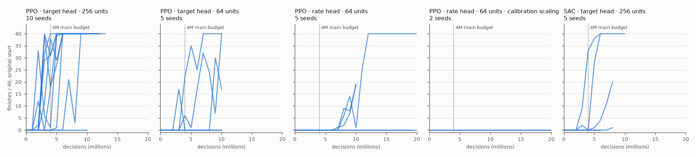
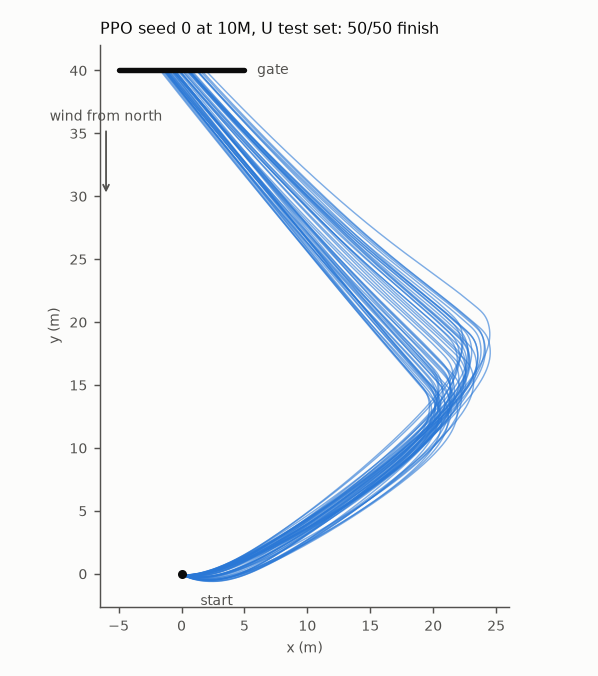

# M6 tuning · PPO and SAC learn the upwind gate without demonstrations

**Post-hoc and exploratory.** On November 19, 2026, from 16:15 (+08:00), a pilot campaign changed only the learners' side of the U contract. Route, dynamics, reward, discount, time limit and the 20 Hz rate actions sent to Rust were unchanged. There were no demonstrations, no privileged resets in the final configuration and no change to any frozen source or store. Every earlier from-scratch PPO/SAC row on U (M4U, M5, M5b, the SAC budget extension and the M6 curricula) finished 0 validation episodes. [Run record](../handoffs/ese3990-m6-tune.md) · [Machine-readable results](M6_tune_results.json)

**Result.** Four learner-side changes, together, let from-scratch PPO learn U. At a 10M-decision budget, **9 of 10 seeds finish every held-out episode: 180/200 validation, 450/500 test and 180/200 shift overall**, with the tenth seed at zero. Every finish contains exactly one settled tack under the frozen M4U classifier. Mean test finish time is 40 s (47 s for seed 4), against 49 s for the offline H = 160 planner and 73 s for RuleSailor on M4U's held-out sets. At the project's 4M main budget, 7 of 10 seeds pass M5's pre-declared threshold (≥ 1/20 validation finishes), with 293/500 test finishes. Keeping the original rate actions instead of the target head, with initial log σ −1.5, PPO passes on 5/5 seeds at 10M (195/250 test). **SAC with the same changes also learns U from scratch: at 10M, 4 of 5 seeds pass, with 73/100 validation and 183/250 test finishes, but only 27/100 on shift** (SAC section below).

| PPO, 10 seeds | Validation | Test | Shift | Seeds with ≥ 1/20 validation | Replayed exactly |
|---|---:|---:|---:|---:|---:|
| 4M decisions, panel-selected | 110/200 | 293/500 | 66/200 | 7/10 | 900/900 |
| 10M decisions, panel-selected | 180/200 | 450/500 | 180/200 | 9/10 | 900/900 |
| Reference: MPC H = 160, offline, 147 ms p50 per decision (M4U) | 60/60 | 150/150 | 60/60 | — | yes |
| Reference: RuleSailor (M4U) | 13/20 | 38/50 | 2/20 | — | yes |





Per-seed 10M rows are 20/20, 50/50 and 20/20 for seeds 0–7 and 9, and 0/0/0 for seed 8. Seed 8 climbed to a mean max y of 38 m at 4M without crossing the line, then retreated to about 6 m by 8–10M. That is the timeout trap described below. The policy is queried once every 10 decisions, and those query decisions cost 0.27 ms (p95 over decisions; the median decision only replays the held target). [Held-out files](../../runs/ese3990/M6/tune/heldout)

## What changed

| Factor | Frozen (M4U/M5) | Pilot setting | Why |
|---|---|---|---|
| Feature scaling | Mean/std of 10k smooth-random calibration decisions, clip ±5 | Fixed physical scales (positions 20 m, heading cos/sin 0.7, speed 1 m/s …), clip ±10 | Calibration stays near the start. Seed 1's `cos_psi` std is 0.14 and its `dy_target` std 6.6 m, so starboard-tack headings and positions within ~12 m of the gate clip at ±5. The same 17 features are used either way |
| Decision interval | 0.05 s | 0.5 s (k = 10, M5's B factor) | The policy output is held for 10 decisions. A learner transition carries the discounted sum of its 10 rewards and γ¹⁰ |
| Network width | 2 × 64 actor and critic | 2 × 256 | Seeds that never learned at 64 learned at 256 (below) |
| Action head | Two rates in [−1, 1] | A rudder-angle and sheet-length target, turned into rates by a dead-beat inner loop on the **observed** actuator state | Exploration noise then perturbs angles rather than rate random walks. Rust still receives rates in [−1, 1]; the loop is part of the agent, like a position-controlled robot joint |
| Collection | One environment, 2,048 decisions per update | 16 environments × 256 policy steps (40,960 decisions) per update, minibatch 512 | Throughput; other PPO settings frozen (lr 3e−4, clip 0.2, 4 epochs, λ 0.95, entropy 0.001, initial log σ −0.5) |

Budgets count every 20 Hz decision. With fixed scaling there is no calibration run.

## Attribution

Pilot-panel finishes out of 40 (deterministic policy, original start, 40 training-distribution conditions). A seed counts as *learned* when it reaches ≥ 17/40.

| Configuration | Seeds learned | Notes |
|---|---|---|
| **Final:** fixed, k = 10, 256 units, target head | **9/10 by 10M** | All nine held 40/40 at every later checkpoint; first 40/40 at 3–9M |
| Same at 64 units | 4/5 within 10M | s0 never; s2 17 at 3M, then 0 to 10M; s1 and s3 oscillate (s1 32, 24, 7, 40 at 7–10M); only s4 holds 40/40 from 7M |
| Same with calibration scaling | 1/2 by 12M | s0 0 through 12M |
| Same at 20 Hz (λ 0.95; also λ 0.995) | 0/1; 0/3 by 10M | s0 max y 25 m; λ 0.995 max y 10–27 m |
| **Rate head**, fixed, k = 10, 256 units, **initial log σ −1.5** | **5/5 finish by 10M** | s0, s1, s4 40/40; s2 13, s3 14 at 9–10M; held-out below |
| Rate head, fixed, k = 10, 256 units, log σ −0.5 | 2/5 | s1 40 from 10M, s3 40 from 13M, s4 ≤ 9, s0/s2 0 |
| Rate head, fixed, k = 10, 64 units | 3/5 by 20M | s0/s1 19 at 10M; s4 40 from 12M to 20M |
| Rate head, **calibration**, k = 10, 64 units (M5's B cell, vectorized) | **0/2 through 20M** | Max y 35–38 m, no training finish |
| Rate head, calibration, 20 Hz, 256 units (width only) | 0/2 through 10M | |
| Rate head, calibration, 20 Hz, 64 units (the M4U PPO setup, vectorized) | 0/1 through 7M | Max y ≈ 0 |

Fixed scaling was necessary for the rate head and helped the target head. With 64 units, roughly half the seeds learned; 256 units made it reliable. At default noise the target head was more reliable than the rate head at both widths. With initial log σ −1.5, the rate head, which keeps the original action semantics and needs no inner loop, also passes on every seed.

| PPO, rate head, 256 units, log σ −1.5, 5 seeds, 10M, panel-selected | Validation | Test | Shift | Seeds ≥ 1/20 validation |
|---|---:|---:|---:|---:|
| Seeds 0–4 | 82/100 | 195/250 | 65/100 | 5/5 |

Per seed (validation, test, shift): s0 20, 50, 20; s1 20, 50, 20; s2 12, 21, 2; s3 10, 24, 10; s4 20, 50, 13. Three seeds are perfect on validation and test. s3's final checkpoint is worse than its selected one (0, 2, 7). [Held-out file](../../runs/ese3990/M6/tune/heldout/rate_k10_h256_ls15_10M.json)

**Failure mode the changes remove.** A stuck policy sails north-east, heads up into the wind and falls back on the same side, repeatedly, until the clock runs out at y ≈ 15–30 m. It never completes a tack, so no training episode crosses the gate line and there is neither a finish nor a miss to learn from. A learned policy bears away to build speed, reaches east, tacks once on the starboard layline (x ≈ 25–40 m, y ≈ 12–17 m) and fetches the gate. Once a seed reaches 40/40, nearly every stochastic training episode also finishes (e.g. 1,251/1,251), and no seed has fallen back.

**Instability at 64 units.** A policy that finished in deterministic evaluation could still fail under exploration noise. At 3M, target-head seed 2 finished 17/40 deterministically but 1/287 stochastic training episodes, with 30 mark misses. With −10 misses dominating its near-gate experience, it retreated into timeouts (≈ −4) and stayed there.

## What did not help

All on the pilot panel, mostly on seeds that were stuck at 64 units:

- **Random starts** (50% of episodes at rest in x ∈ [−30, 30], y ∈ [0, 38] m with uniform heading): original-start progress fell to max y ≈ 0–16 m through 4M for both heads.
- **Training-only failure penalty 3 instead of 10:** about 1,200 episodes per 1M, all ending in early failures and none finishing. A cheap failure beats paying the time cost, so the frozen ordering −10 failure < timeout < finish is doing real work.
- **Mirror-equivariant networks.** U is mirror-symmetric to float precision, so the actor and critic were symmetrized exactly. Target head at k = 10: 0/40 on both seeds through 10M.
- **Pink exploration noise** (β = 1, PPO): no learning on hard seeds through 8–9M. Initial log σ 0: none. λ = 0.98 or 0.99: none. 64 environments × 64 steps: one late, unstable seed. LR 1e−4, or linear annealing with KL early stopping: none.
- **k = 20:** rate-head seeds discover but oscillate (≤ 35); target-head s0 reached 40.

## SAC

SAC used the frozen update: twin Q, Polyak 0.005, learned α, target entropy −2, batch 256, one update per policy step. It shared PPO's scaling, target head, 0.5 s decisions and 256-unit networks, and its networks ran on the GPU through a separate JAX venv (see the run record). Seeds 0–4 are reported. Seeds 5–9 on the CPU were stopped at 3M when the campaign closed (s6 had 5/40; the others 0). The 10M SAC row passes the threshold (≥ 1/20 validation) on 4/5 seeds. Held-out, panel-selected:

| SAC, target head, 256 units, 5 seeds | Validation | Test | Shift | Seeds ≥ 1/20 validation |
|---|---:|---:|---:|---:|
| 4M decisions | 17/100 | 45/250 | 0/100 | 1/5 |
| 10M decisions | 73/100 | 183/250 | 27/100 | 4/5 |

Per seed at 10M (validation, test, shift): s0 20, 50, 20; s1 13, 33, 0; s2 20, 50, 0; s3 20, 50, 7; s4 0, 0, 0. Pilot curves: s0 reached 40/40 at 7M and held it with 1,183/1,186 training finishes. Its critic stayed bounded (Q mean 8.7, max 10.1, inside the feasible band). s3 reached 40/40 at 7M, s2 at 10M, and s1 was at 32/40 at 10M. **SAC learns U, but later than PPO and with much weaker transfer to the shift set** (27% versus 90% for PPO at 10M).

- **Width is required for SAC too.** At 64 units on the CPU, both heads score 0/40 through 10M, with α ≈ 0.001, Q drifting to −6 and max y ≤ 13 m.
- **Not reproducible on the GPU.** GPU SAC runs are not bitwise reproducible. A 20M rerun of seed 4 with identical settings reached 40/40 by 3M, while the original seed-4 run had none through 10M. The table reports the original runs. Every stored held-out episode is generated and replayed on the CPU and replays exactly.
- **UTD 2** (two updates per policy step) did not make SAC more reliable. By 6M only s2 had learned (40/40 from 4M; UTD 1 reached it at 10M); s0, s3 and s4 were 0 at 6M, where UTD 1 had s0 and s3 at 40. s1 stayed at 0 through 10M.
- **No help by 3–5M:** target entropy 0, n-step 8 with target entropy 0, LayerNorm critics, pink noise, and the rate head at 256 units.

## What this means for the earlier readings

The M4U–M6 readings remain correct for the configuration they froze. "M5 closes: from-scratch PPO/SAC do not solve U under these budgets and changes" still describes 2 × 64 networks with calibration scaling. This campaign narrows the cause:

- **The learner configuration blocked U, not the learning algorithms.** M5's 0.5 s decision blocks (factor B) were not sufficient. B with calibration scaling stayed at 0 through 20M here too. With fixed scaling, the same rate-head PPO learned on 3/5 seeds. Adding width made the target-head PPO learn on 9/10 seeds.
- **More or differently colored exploration noise did not substitute for the configuration.** On seeds stuck at 64 units, pink noise and a larger initial σ did not help, and random starts hurt. *Less* initial noise (log σ −1.5) did help the rate head at 256 units.
- **Learning versus planning on U.** At 10M training decisions, the learned policies match the H = 160 planner's held-out finish rate. They finish faster (40 s versus 49 s mean) and cost ≈ 0.3 ms per policy query against 147 ms p50 per MPC decision. The planner needs no training but has the exact model; the learner needs 10M simulator decisions (2.5× the main budget). At the 4M main budget, 7/10 PPO seeds learn.

## Beyond the frozen sets (stress test)

The nine converged 10M policies were also run on 32 conditions outside every frozen range: wind 3.5, 4, 6 and 7 m/s × wind direction −15°, −10°, +10°, +15° × start heading 60° or 120°. Training used 4.5–5.5 m/s, ±5° and 75–105°. Together they finished **211/288 (73%)**, between 15 and 30 per seed, and all 288 episodes replay exactly. Failures concentrate in two places:

- Wind direction is asymmetric: +10° 68/72 and +15° 62/72, but −10° 55/72 and −15° 26/72. Every policy sails port tack first and tacks once. With the wind backed 15° (from the NNW), that plan no longer fits the gate.
- Wind speed: 4 m/s 63/72 and 6 m/s 58/72; 3.5 m/s 46/72 and 7 m/s 44/72.

Start heading does not matter: 105/144 at 60° and 106/144 at 120°. [Stress evaluations](../../runs/ese3990/M6/tune) (`eval_*_stress/` in each `b9_tgt_k10_h256_s*` run).

## Caveats

- **Post-hoc and exploratory.** The design of each batch used earlier pilot outcomes. Every configuration and checkpoint was chosen on the training-distribution pilot panel; validation, test and shift were opened only after selection. No M4/M4U/M5 row is replaced.
- **Budget.** The 10M PPO rows use 2.5× the 4M main budget. The 4M rows are the budget-matched comparison with M4U/M5.
- **Learner changes.** The four changes are not independent: the attribution table varies one at a time around the final configuration on a few seeds, not a factorial design. The target head adds an agent-side inner loop, so the policy's action is a set-point, not a rate. The rate-head row above keeps the original action semantics and needs initial log σ −1.5 instead.
- **One strategy.** Every learned policy uses the same one-tack layline approach. It degrades when the wind backs by more than 10° (stress test above).
- Pilot-panel scores come from batched inference. The stored held-out episodes are scored one at a time; on one checkpoint the two differed by 18 vs 20/40, because chaotic trajectories amplify float32 differences.

## Reproduce

```
cd experiments/ese3990
env -u PYTHONPATH XLA_FLAGS=--xla_cpu_multi_thread_eigen=false OPENBLAS_NUM_THREADS=1 \
  ../../.venv/bin/python m6_tune.py NAME --seed S --head target --repeat 10 --hidden 256 --decisions 10e6
../../.venv/bin/python m6_tune_heldout.py OUT.json NAME_sS ... --budget 10.1e6
../../.venv/bin/python m6_tune_results.py ../../docs/ese3990/M6_tune_results.json
```

Code: [`m6_tune.py`](../../experiments/ese3990/m6_tune.py) (trainer), [`m6_tune_eval.py`](../../experiments/ese3990/m6_tune_eval.py) (stored, replayed held-out episodes + tack diagnostics), [`m6_tune_heldout.py`](../../experiments/ese3990/m6_tune_heldout.py), [`m6_tune_plot.py`](../../experiments/ese3990/m6_tune_plot.py), [`m6_tune_results.py`](../../experiments/ese3990/m6_tune_results.py). The tests in [`test_m6_tune.py`](../../experiments/ese3990/tests/test_m6_tune.py) check step parity with `TaskEnv.step`, GAE parity with `ppo.gae`, the target head, mirror symmetry and the n-step bookkeeping.
