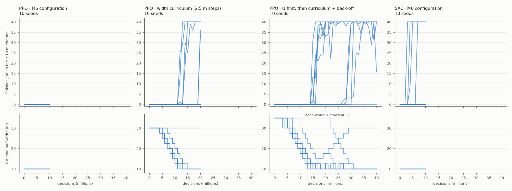
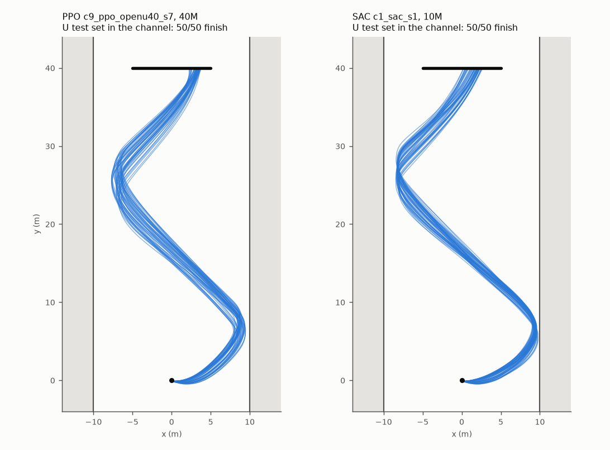
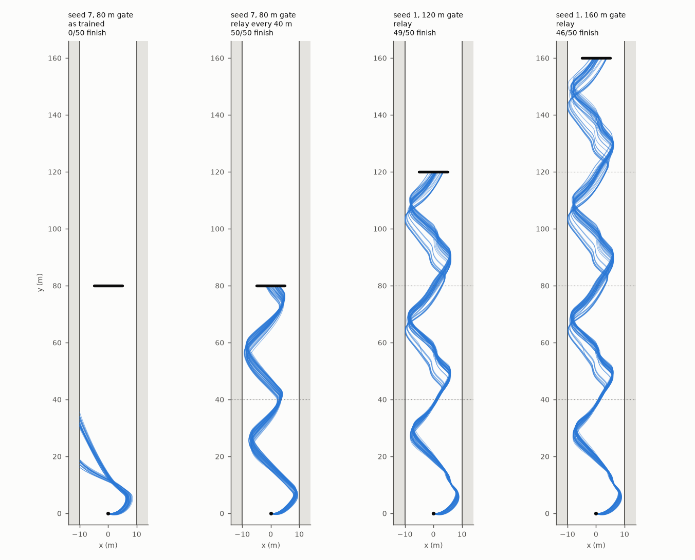

# M7 · Channel beat · PPO and SAC string two tacks together

**Post-hoc and exploratory.** On November 20, 2026, from 01:10 (+08:00), a 4-hour campaign trained PPO and SAC from scratch on a channel version of U. The x bounds were narrowed from [−80, 120] to [−10, 10] m. Route, start, gate, dynamics, reward, discount, the 180 s budget and the 20 Hz rate actions sent to Rust were unchanged. There were no demonstrations and no privileged resets, and no frozen source or store changed. The learner side is M6 tuning's final configuration: fixed feature scaling, 0.5 s decisions, 2 × 256 networks and the target head. [Run record](../handoffs/ese3990-m7-channel.md) · [Machine-readable results](M7_channel_results.json) · [Plan section](ESE3990_SailGym_Project_Plan.md#m7--channel-beat-string-several-tacks-together--started-november-20)

**Result.** Unchanged, the M6 recipe fails the channel with PPO, 0 of 10 seeds, and half-works with SAC, 4 of 10 seeds learning. A training-side width curriculum fixes PPO. The curriculum trains first in open-water U, where the M6 recipe already learns one tack, then narrows the channel in 2.5 m steps with a back-off. **At 40M decisions, 9 of 10 PPO seeds are perfect on validation (20/20) and test (50/50): 180/200 and 450/500 overall, the same totals as M6 tuning's open-water PPO at 10M.** Shift is weaker: 134/200, against M6's 180/200. At 30M the same runs are at 8/10 passing, 7/10 perfect. The extra 10M let two seeds that were still mid-transition finish it.

Every learned policy, PPO or SAC, sails the route the planner found: tack near the right wall at y ≈ 6 m, cross, tack again near x ≈ −8 m, y ≈ 26 m, then reach the gate. Mean test finish times for the nine 40M seeds are 44–52 s, except seed 9 at 100 s; the offline H = 160 planner takes 49 s. The policy needs 0.2 ms per query (p95), against about 300 ms per planner decision.

| Arm, panel-selected checkpoints | Seeds | Budget | Validation | Test | Shift | Seeds with ≥ 1/20 validation |
|---|---:|---:|---:|---:|---:|---:|
| PPO, M6 configuration (`c1`) | 10 | 10M | 0 on the panel at every checkpoint | | | 0/10 |
| PPO, ±30 → ±10 m curriculum, 2.5 m steps (`curr25`) | 10 | 20M | 115/200 | 276/500 | 71/200 | 6/10 |
| PPO, as above with 1.25 m steps (`curr125`) | 5 | 25M | 62/100 | 167/250 | 60/100 | 4/5 |
| PPO, 2.5 m steps, back-off after 2 empty panels (`back`) | 5 | 25M | 60/100 | 152/250 | 60/100 | 3/5 |
| PPO, open-water U first, then `back` (`openu`) | 10 | 30M | 141/200 | 362/500 | 89/200 | 8/10 |
| **PPO, `openu` with a 40M budget (`openu40`)** | **10** | **40M** | **180/200** | **450/500** | **134/200** | **9/10** |
| SAC, M6 configuration (`c1`) | 10 | 10M | 80/200 | 200/500 | 62/200 | 4/10 |
| Reference: planner H160_K32, validation-000 to -007 | — | offline | 8/8 | — | — | — |
| Reference: M6 tuning PPO in open water | 10 | 10M | 180/200 | 450/500 | 180/200 | 9/10 |





Per-seed `openu40` rows (validation / test / shift; mean test finish time), with the same seeds at 30M (`openu`):

| Seed | 0 | 1 | 2 | 3 | 4 | 5 | 6 | 7 | 8 | 9 |
|---|---|---|---|---|---|---|---|---|---|---|
| 40M | 20/50/13 | 20/50/16 | 20/50/20 | 20/50/14 | 20/50/20 | 20/50/8 | 0/0/0 | 20/50/20 | 20/50/9 | 20/50/14 |
| Test finish | 52 s | 49 s | 45 s | 44 s | 45 s | 45 s | — | 44 s | 46 s | 100 s |
| 30M | 1/12/0 | 20/50/16 | 20/50/0 | 20/50/15 | 20/50/10 | 20/50/16 | 0/0/0 | 20/50/20 | 0/0/5 | 20/50/7 |

`openu40` reproduces `openu` exactly for the first 30M on all ten seeds (identical panel logs); CPU PPO is deterministic. Seed 4 was selected at 39M: its 40M checkpoint dropped to 16/40 on the panel and scores 8/20, 22/50 and 9/20. All 5,040 held-out episodes in this campaign replay exactly. [Held-out files](../../runs/ese3990/M7/train/heldout)

## The task is feasible, and the M6 policies fail it

Before any training, the frozen M4U planner (H160_K32, search seed 0) finished 8/8 of validation-000 to -007 in the channel. It used 2 tacks each, with a mean of 49.1 s against 48.3 s in open water ([figure](figs/M7_channel_mpc_half10_tracks.png)). The nine converged M6 PPO policies, run zero-shot, finished 0/450 test episodes at ±15, ±10 and ±7.5 m. In open water they sail about 21 m to one side and tack once on the layline.

The geometry shows why ±10 m is a genuinely different task. Close-hauled, the planner's course over ground is about 34° off the wind, so one tack fetches the 5 m gate only if the first board reaches x ≈ 13 m. Any channel narrower than about ±12.5 m therefore needs a second tack. The second tack is also the mirror manoeuvre, starboard to port, which a one-tack policy has never made: it starts on port (heading east, wind from the north) and tacks once onto starboard.

## PPO: the wall makes the timeout trap stronger

With the M6 configuration, all ten PPO seeds end at 10M with every panel episode a timeout. Mean max y is 17–30 m and log σ has fallen to about −1.2. A random early policy beam-reaches into the wall within about 10 s and scores −10. PPO quickly learns to avoid the wall by hovering (a timeout is worth about −4), and then never explores a tack. Three cheap fixes did not change that at 10M on three seeds each: entropy coefficient 0.01, half the starts random inside the channel, and M6's rate head with log σ −1.5.

**A width curriculum separates the two problems.** Training starts at ±30 m. Each time the deterministic panel at the current width finishes ≥ 30/40, the channel shrinks; the logged `eval`, which drives checkpoint selection, is always at ±10 m. With 5 m steps (3 seeds), PPO learns ±30 m and shrinks cleanly to ±15 m at 40/40. At ±10 m it collapses to 0 and stays there; one seed collapsed at ±25 m. With 2.5 m steps, the policy passes ±12.5 m, the last width where one tack still works. It then has to add the second tack at ±10 m. 6 of 10 seeds did so within 20M, usually after 1–3M of 0–25/40 at ±10 m, with episodes ending at the wall rather than in timeouts. The failures fall into two kinds:

- **Never learning the first phase.** 2 of 10 seeds never finish at ±30 m.
- **Not recovering at ±10 m within the budget.** 2 of 10 seeds.

**The first-phase failures trace to early wall contact.** A ±80 m first phase (`c7`) let only 3/10 seeds reach 30/40 by 8–9M, against 9/10 for M6 in U, whose bounds differ only by the east wall at 120 m instead of 80 m. A beam-reaching early policy drifts that far within 180 s, so even a distant wall turns early drift into −10 failures. `openu` therefore makes phase 1 U itself. Training is bit-identical to M6 tuning until the first switch; the 3M panel scores match `b9_tgt_k10_h256` seed for seed. After the switch it uses ±30 m, 2.5 m steps, and a back-off that widens one step after 2 consecutive 0/40 panels. Nine seeds left U at 3–10M; seed 8 needed 22M, matching its M6 failure. Those nine reached ±10 m at 13–18M. By 30M, 7 were at 39–40/40, seed 0 was at 3/40, and seed 6 had backed off to ±27.5–30 m and was still relearning. With 10M more (`openu40`), seed 0 recovered to 40/40 by 35M. Seed 8 reached ±10 m at 31M and scored 40/40 at once. Seed 6 stayed at 0, back at ±30 m.

**Gentler steps and back-off help, and the budget binds.** `curr125` (1.25 m steps, panel every 0.5M) piles up at ±11.25 m, where a second tack first becomes necessary, then passes on 4/5 seeds. `back` passes on 3/5. All three `c7` seeds that passed their ±80 m phase went on to perfect validation and test scores (60/60 and 150/150). Most failures are seeds still mid-transition when the budget ends, not seeds that cannot learn the transition.

## SAC learns the channel directly, but on fewer seeds

With the M6 configuration and no curriculum, SAC seeds 1, 3, 4 and 6 learn the two-tack route at 3–7M and hold 40/40 through 10M. They finish 20/20 validation, 50/50 test and 20, 9, 20 and 13 of 20 shift, with a mean test finish of 46 s. The other six never finish; seed 0, for example, ends with α ≈ 1e-4, Q ≈ −5.5 (the timeout value) and 38/40 panel timeouts. That is 4/10, against M6 SAC's 4/5 in open water.

Two SAC variants did not help. Per-episode width mixing in [10, 30] m learned on 1/5 seeds (30/40 at 10M). SAC with the `openu` curriculum (5 seeds, 20M) finished 0/40 on the ±10 m panel at every checkpoint, so no held-out evaluation was run. It collapses at width switches. Seed 1 went from 40/40 in U to 0 at ±30 m, back to 40, then oscillated between ±20 and ±22.5 m. Seeds 2 and 4 narrowed cleanly to ±15 m, then fell to 0 at ±12.5 m, at the same one-to-two-tack boundary where PPO breaks. Seeds 0 and 3 never left U in 20M. For SAC, training directly at ±10 m is the better arm.

## What did not help

| Change (PPO unless stated) | Seeds | Budget | Panel at ±10 m |
|---|---:|---:|---|
| Entropy coefficient 0.01 | 3 | 10M | 0 |
| Half the starts random in the channel | 3 | 10M | 0, hovering near the start |
| Rate head, log σ −1.5 | 3 | 10M | 0 |
| Curriculum with 5 m steps | 3 | 20M | 0 after collapsing at ±10 m (two seeds) or ±25 m (one) |
| Per-episode width in [10, 30] or [10, 20] m | 3 + 3 | 20M | 0, and 0 at the widest width too |
| Mirror-equivariant nets (M6's `--equivariant`), with or without a curriculum | 3 + 3 | 10M / 12M | 0, and 0 at ±30 m |
| SAC with per-episode width in [10, 30] m | 5 | 10M | 30 on seed 0 only |
| SAC with the `openu` curriculum | 5 | 20M | 0; two seeds collapse at ±12.5 m, two never leave U |

Equivariance was tested because the missing second tack is the mirror of the first. It suppressed learning entirely, as it did in open water in M6.

## Tack counts and the classifier

Under the frozen M4U classifier, finished channel episodes mostly count 2 settled tacks. Several perfect PPO seeds count fewer: `openu` seed 2 counts 0 on every finish and seed 9 counts 1. Their tracks show two direction reversals, with legs sailed at 20–28° true wind angle, inside the classifier's 30° head-to-wind zone. The planner did the same on validation-006. Seed 9 is also messy: it stalls near the gate, falls back to y ≈ 27 m and comes round again, so its mean test finish is 103 s. Tack counts in this report are therefore read together with the tracks. The classifier was not changed.

## Longer channels: the route is memorized, but it chains (zero-shot, post-hoc)

I ran the ten `openu40` policies, unchanged, in the same ±10 m channel with the gate moved further upwind. Gates at 80, 120 and 160 m need about 4, 6 and 8 tacks. The time limit is 360 s and the top bound is the gate + 60 m; everything else is as in training. The policy never observes time. Its distance-to-gate input reaches 80–160 m, beyond the ≤ 40 m seen in training. The runs use the U test conditions. Boards are counted as reversals in x of at least 3 m, because the classifier undercounts pinched tacks (`experiments/ese3990/m7_channel_long.py`; `runs/ese3990/M7/long/`).

| Gate | As trained, 10 seeds | Relay every 40 m, 10 seeds | Best seeds with relay | Boards per finish with relay |
|---|---:|---:|---|---|
| 40 m | 450/500 | 450/500 | 9 seeds at 50/50 | 2 |
| 80 m | 36/500 | 322/500 | s7 50, s1 49, s3 49, s8 47 | 4 |
| 120 m | 0/500 | 246/500 | s1 49, s7 46, s8 46 | 6–7 |
| 160 m | 0/500 | 210/500 | s1 46, s8 46, s7 40 | 8–9 |

**As trained, the policies do not generalize to longer routes.** Most seeds still tack at the right wall as in training, but they never make the next tack. Seed 7 reaches x ≈ −8 m about 50 m short of the gate and sails into the left wall; its second tack in training came about 14 m below the gate. Others hang at the right wall and never tack. Only seed 3 finishes at 80 m (36/50). The walls are not observed, so the policy keys its tacks to position relative to the gate. Every gate offset it met in training was within 40 m, so its two tacks are a memorized route, not a rule such as "tack before the wall".

**The 40 m skill chains, though.** In the relay, the policy sees a virtual gate at 40, 80, 120 … m, which advances once the boat passes it and is capped at the real gate. Without retraining, four seeds then finish 46–50/50 at 80 m, and seeds 1 and 8 finish 46/50 at 160 m with 8 clean tacks. Finish time grows by about 48 s per 40 m leg (seed 1: 49, 97, 145 and 194 s). Later legs start at speed rather than at rest, so they differ from training: the policy tacks at x ≈ 5 m instead of at the wall. Weaker seeds fail on those later legs (seed 9: 3/50 at 80 m).



A policy that tacks on its own over any length would need training with a varied gate distance or start position, or a wall-relative input. The relay is a hand-built waypoint layer, like the course layer's marks, not a learned skill.

## Caveats

- **Post-hoc and exploratory.** Each batch was designed from earlier pilot outcomes within the same 4-hour budget. Checkpoints were selected on the training-distribution panel at ±10 m before validation, test and shift were opened. Selected checkpoints are the final ones for most seeds.
- **Budget.** The curriculum arms use 20–40M decisions. The 9/10 row costs 40M, 4× the M6 row it matches and 10× the 4M main budget. PPO trains 10M decisions in about 15 minutes with 15 runs sharing the 24-core CPU.
- **Training-side task change.** The curriculum changes the training environment's bounds. The policy, its inputs and the evaluated task are unchanged. The walls are never observed: a policy infers them from its x position, so it is specific to ±10 m.
- **Shift.** PPO `openu40` finishes 134/200 on shift (wind 4 or 6 m/s, heading offset 15–30°), against 450/500 on test. Shift scores also move between neighbouring checkpoints: seed 2 scored 0/20 at 30M and 20/20 at 40M.
- **GPU SAC is not bit-reproducible.** PPO and the planner are deterministic on CPU.
- Pilot-panel scores come from batched inference and stored held-out episodes are scored one at a time, as in M6.

## Reproduce

```bash
cd experiments/ese3990
# planner feasibility (validation-000..007), tracks figure
RAYON_NUM_THREADS=3 ../../.venv/bin/python m7_channel_mpc.py --half 10 --n 8 --jobs 8
../../.venv/bin/python m7_channel_plot.py 10 0
# best PPO arm, one seed (CPU; GPU SAC via runs/ese3990/M7/launch_gpu.sh)
../../runs/ese3990/M7/launch.sh c9_ppo_openu40 0 --learner ppo --norm fixed --repeat 10 \
    --hidden 256 --head target --curriculum 30 2.5 30 --backoff 2 --open-first-u --decisions 40e6
# held-out (panel-selected), curves, results, figures
../../.venv/bin/python m7_channel.py heldout ../../runs/ese3990/M7/train/heldout/X.json c8_ppo_openu_s0
../../.venv/bin/python m7_channel.py report c8
../../.venv/bin/python m7_channel.py results ../../docs/ese3990/M7_channel_results.json
../../.venv/bin/python m7_channel_figs.py c9_ppo_openu40_s7 c1_sac_s1
```

`m7_channel.py` runs the M6 tuning trainer, evaluator and held-out driver unchanged, swapping their `Task.load("U")` for the channel task. Held-out stores record `m7_channel_half_m` in their run identity, because the episode index still says task `U`. Replay must use the channel task.
