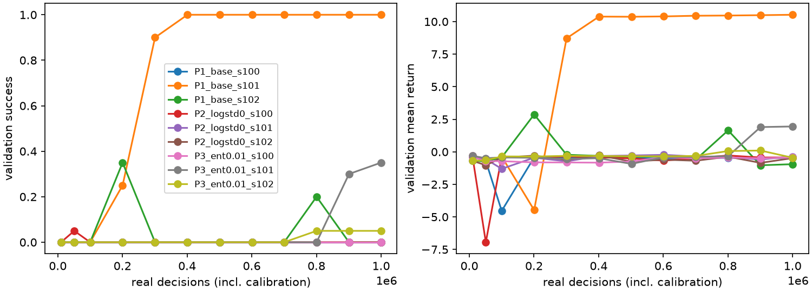
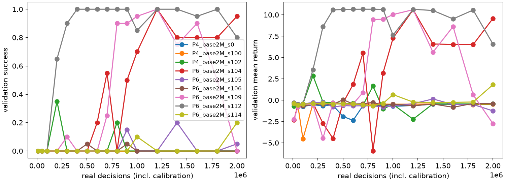
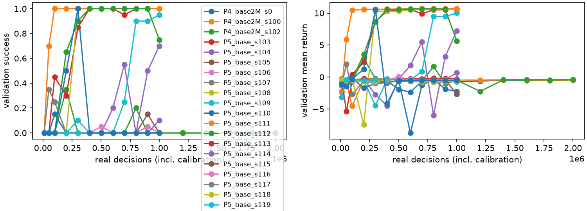

# PPO tuning log: task R

A record of every PPO configuration tried before the final runs (ESE3990 plan §5 E1: "at most three 100k-decision pilot configurations per learner on validation conditions; record pilot cost separately"). Newest entry last. Never delete an entry, including failed ones.

**Ground rules**

* Pilots use **pilot seeds 100+**, never the final training seeds `[0..4]`, and are judged on **validation** only. Test documents stay closed.
* Change only the PPO `CONFIG` in `experiments/ese3990/train.py`, via `--set key=value`. Task, reward, gate, features and calibration are the frozen contract (M0/M1 reports); they are not tuning knobs.
* Charge every decision. Pilot cost goes in the entry.

**Adding an entry**

```bash
# run (one seed per process; XLA single-threaded so 9 runs share the CPU fairly)
XLA_FLAGS=--xla_cpu_multi_thread_eigen=false env -u PYTHONPATH uv run --frozen --no-sync \
  python experiments/ese3990/train.py --seed 100 --decisions 1000000 \
  --checkpoints 10000,50000,100000,200000,300000,400000,500000,600000,700000,800000,900000,1000000 \
  --set ent_coef=0.01 --out runs/ese3990/ppo/pilots/P3_ent0.01_s100
# table rows + curve figure
MPLCONFIGDIR=/tmp/mpl env -u PYTHONPATH uv run --frozen --no-sync python experiments/ese3990/plots.py \
  --table runs/ese3990/ppo/pilots/P3_*/ --out docs/rl/figs/<name>.png
```

Table columns: run · pilot seed · change from `CONFIG` · validation finished at 100k · at the end of the budget · best checkpoint · training episodes **finished / mark-missed / total** · final σ (rudder, sheet) · wall seconds.

---

## Starting point (M1, 2026-11-13)

`CONFIG` = plan §4.5 values: log σ₀ = −0.5 (σ ≈ 0.61), c_H = 0.001, c_V = 0.5, clip 0.2, λ = 0.95, lr 3e−4, rollout 2048, minibatch 256, 4 epochs, grad-norm cap 1.0, 2×64 tanh MLPs.

| Run | Seed | Change | Val @100k | Val @end | Best | Train fin / miss / eps | Final σ | Wall s |
|---|---|---|---|---|---|---|---|---|
| `R_pilot_s0` | 0 | baseline, 100k | 0/20 | 0/20 | 0/20 | 0 / 1 / 101 | 0.60, 0.60 | 14 |
| `R_s0_1M` | 0 | baseline | 0/20 | 0/20 | 0/20 | 6 / 24 / 1112 | 0.49, 0.53 | 93 |

These used final seed 0, so they are the M1 curve rather than tuning evidence; no setting was chosen from them. The hypothesis they produced: PPO reaches the gate line around 500k decisions, eats −10 mark-miss penalties, and retreats to a safe 45 s drift. That suggests an exploration problem.

## P1–P3 · 2026-11-13 · exploration noise vs entropy bonus

**Question:** does more exploration get PPO to the gate reliably? P2 starts with σ = 1 (log σ₀ = 0). P3 uses a 10× entropy bonus (c_H = 0.01). P1 is the unchanged baseline on the same pilot seeds, for a fair comparison.

**Cost:** 9 runs × 1M decisions = **9M pilot decisions**, 3 min wall-clock (9 processes in parallel, ~180 s each). Budget note: the plan's pilot rule says 100k decisions per configuration. Each run here went to 1M because the 100k checkpoint shows nothing for any configuration (all 0/20). The 100k column is kept for the rule, and the remaining checkpoints are extra pilot cost, recorded here.

| Run | Seed | Change | Val @100k | Val @end | Best | Train fin / miss / eps | Final σ | Wall s |
|---|---|---|---|---|---|---|---|---|
| `P1_base_s100` | 100 | baseline | 0/20 | 0/20 | 0/20 | 0 / 16 / 1103 | 0.41, 0.49 | 180 |
| `P1_base_s101` | 101 | baseline | 0/20 | **20/20** | 20/20 @ 400k–1M | 1434 / 104 / 1715 | 0.37, 0.27 | 171 |
| `P1_base_s102` | 102 | baseline | 0/20 | 0/20 | 7/20 @ 200k | 17 / 18 / 1111 | 0.43, 0.40 | 178 |
| `P2_logstd0_s100` | 100 | log_std=0.0 | 0/20 | 0/20 | 1/20 @ 50k | 6 / 24 / 1105 | 0.78, 0.82 | 180 |
| `P2_logstd0_s101` | 101 | log_std=0.0 | 0/20 | 0/20 | 0/20 | 1 / 13 / 1104 | 0.69, 0.69 | 181 |
| `P2_logstd0_s102` | 102 | log_std=0.0 | 0/20 | 0/20 | 0/20 | 4 / 34 / 1106 | 0.74, 0.82 | 178 |
| `P3_ent0.01_s100` | 100 | ent_coef=0.01 | 0/20 | 0/20 | 0/20 | 12 / 11 / 1105 | 0.72, 0.67 | 174 |
| `P3_ent0.01_s101` | 101 | ent_coef=0.01 | 0/20 | 7/20 | 7/20 @ 1M | 17 / 22 / 1107 | 0.72, 0.58 | 180 |
| `P3_ent0.01_s102` | 102 | ent_coef=0.01 | 0/20 | 1/20 | 1/20 @ 900k | 6 / 14 / 1106 | 0.65, 0.69 | 185 |



Validation finished per checkpoint (10k, 50k, 100k, 200k, 300k, …, 1M):

```
P1_base_s101     0 0 0 5 18 20 20 20 20 20 20 20   <- solves R; return ≈ +10.5, stable to 1M
P1_base_s102     0 0 0 7  0  0  0  0  0  4  0  0   <- finds the gate twice, loses it twice
P3_ent0.01_s101  0 0 0 0  0  0  0  0  0  0  6  7   <- late, still rising at 1M
P3_ent0.01_s102  0 0 0 0  0  0  0  0  0  0  1  1
everything else  0 at every checkpoint (P2_s100: 1/20 once at 50k)
```

**Findings**

1. **PPO with the plan's starting values can solve R.** Pilot seed 101 goes from 0/20 to 20/20 between 100k and 400k decisions and holds it to 1M: 1,434 of 1,715 training episodes finished. M1's seed-0 failure was one unlucky seed, not evidence that the configuration cannot work.
2. **The dominant effect is the seed, not the setting.** Under the baseline, one seed solves R, one finds the gate and loses it (7/20 at 200k, 0 at 300k), and one never gets there. Three seeds per configuration can only detect large differences.
3. **A larger σ (P2) is worse.** No seed rises above 1/20, σ *grows* (0.7–0.8), and the policy is too noisy to hold a 10 m gate. It also has the highest mark-miss counts (seed 102: 34 misses against 4 finishes). Rate-space white noise does not turn into useful exploration; it turns into misses.
4. **A higher entropy bonus (P3) is slower but plausibly more stable.** It never collapses into the "stop exploring" basin as early (σ stays near 0.65–0.72), and two seeds are still rising at 1M (7/20 and 1/20). It is not better than the baseline within 1M.

**Decision (proposed, needs your sign-off):** keep the plan §4.5 baseline. Neither change beats it, and P2 is clearly worse. This uses up the plan's pilot allowance (baseline + 2 changes = 3 configurations). Given the seed variance, the useful levers now are:

* **More seeds rather than more tuning.** Run the final E1 with all five seeds `[0..4]`; PPO costs ~1.5 min per 1M.
* **A budget that lets late-rising runs finish.** P3_s101 was still improving at 1M. Whether the common budget is 1M or longer is decided in M2 together with SAC's runtime.
* **Untried:** time-correlated exploration noise. It changes the policy's likelihood (actions are no longer conditionally independent per step), so it needs either a state-dependent noise design such as gSDE or action repeat, and its own E0 checks. Count it as a new configuration, beyond the plan's allowance, if pursued.

**Reproducibility:** these runs used `XLA_FLAGS=--xla_cpu_multi_thread_eigen=false`. Same-seed determinism is tested without the flag (`tests/test_ppo.py`). P4 later showed the flag does not change the results (seed 0 matches `R_s0_1M` exactly).

## P4–P6 · 2026-11-13 · longer budget vs more seeds (baseline config only)

**Question:** is a longer budget (2M) or more seeds the better use of compute? No configuration change; every run uses the plan §4.5 baseline.

* **P4:** the three baseline seeds that failed by 1M (0, 100, 102), rerun to 2M. Seed 0 is a final seed. It is used here only as a diagnostic of the M1 run, and its first 1M is identical to `R_s0_1M` (below).
* **P5:** 18 new pilot seeds (103–120) at 1M.
* **P6:** the six P5 seeds still moving at 1M (104, 109, 112, plus the small blips 105, 106, 114), rerun to 2M.

**Cost:** 3×2M + 18×1M + 6×2M = **36M pilot decisions**, 13 min wall-clock (21 parallel processes, then 6).

**Reproducibility, now checked.** All 9 rerun seeds reproduce their earlier runs exactly at every shared checkpoint through 1M. This includes seed 0, whose earlier run was **without** the XLA flag, so the flag does not change the floats. A 2M rerun is a strict extension of the 1M run.

| Run | Seed | Change | Val @100k | Val @end | Best | Train fin / miss / eps | Final σ | Wall s |
|---|---|---|---|---|---|---|---|---|
| `P4_base2M_s0` | 0 | baseline, 2M | 0/20 | 0/20 | 0/20 | 6 / 24 / 2224 | 0.30, 0.42 | 454 |
| `P4_base2M_s100` | 100 | baseline, 2M | 0/20 | 0/20 | 0/20 | 0 / 18 / 2215 | 0.32, 0.34 | 451 |
| `P4_base2M_s102` | 102 | baseline, 2M | 0/20 | 0/20 | 7/20 @ 200k | 18 / 21 / 2224 | 0.27, 0.30 | 453 |
| `P5_base_s103` | 103 | baseline | 9/20 | **20/20** | 20/20 @ 400k–1M | 1559 / 119 / 1960 | 0.38, 0.39 | 353 |
| `P5_base_s104` | 104 | baseline | 0/20 | 14/20 | 14/20 @ 1M | 343 / 153 / 1236 | 0.47, 0.50 | 361 |
| `P5_base_s105` | 105 | baseline | 0/20 | 0/20 | 3/20 @ 900k | 12 / 28 / 1109 | 0.46, 0.45 | 364 |
| `P5_base_s106` | 106 | baseline | 0/20 | 0/20 | 1/20 @ 500k | 7 / 18 / 1105 | 0.44, 0.47 | 364 |
| `P5_base_s107` | 107 | baseline | 0/20 | 0/20 | 0/20 | 1 / 14 / 1102 | 0.45, 0.46 | 354 |
| `P5_base_s108` | 108 | baseline | 0/20 | **20/20** | 20/20 @ 300k–1M | 1632 / 62 / 1943 | 0.32, 0.38 | 344 |
| `P5_base_s109` | 109 | baseline | 0/20 | 19/20 | 19/20 @ 1M | 436 / 36 / 1356 | 0.41, 0.49 | 364 |
| `P5_base_s110` | 110 | baseline | 3/20 | 0/20 | 3/20 @ 100k | 37 / 78 / 1133 | 0.46, 0.35 | 349 |
| `P5_base_s111` | 111 | baseline | 20/20 | **20/20** | 20/20 @ 100k–1M | 2830 / 19 / 2885 | 0.32, 0.20 | 327 |
| `P5_base_s112` | 112 | baseline | 0/20 | 15/20 | 20/20 @ 400k–700k | 2215 / 83 / 2456 | 0.34, 0.33 | 344 |
| `P5_base_s113` | 113 | baseline | 0/20 | 0/20 | 0/20 | 4 / 11 / 1102 | 0.45, 0.42 | 358 |
| `P5_base_s114` | 114 | baseline | 0/20 | 2/20 | 2/20 @ 1M | 10 / 13 / 1103 | 0.45, 0.41 | 361 |
| `P5_base_s115` | 115 | baseline | 0/20 | 0/20 | 0/20 | 2 / 15 / 1103 | 0.47, 0.44 | 363 |
| `P5_base_s116` | 116 | baseline | 0/20 | 0/20 | 0/20 | 0 / 3 / 1101 | 0.46, 0.41 | 364 |
| `P5_base_s117` | 117 | baseline | 5/20 | 0/20 | 7/20 @ 50k | 16 / 40 / 1124 | 0.45, 0.45 | 362 |
| `P5_base_s118` | 118 | baseline | 0/20 | 0/20 | 0/20 | 0 / 2 / 1101 | 0.44, 0.34 | 350 |
| `P5_base_s119` | 119 | baseline | 0/20 | 0/20 | 0/20 | 0 / 9 / 1101 | 0.42, 0.36 | 359 |
| `P5_base_s120` | 120 | baseline | 0/20 | 0/20 | **20/20 @ 300k** | 208 / 197 / 1280 | 0.45, 0.38 | 366 |
| `P6_base2M_s104` | 104 | baseline, 2M | 0/20 | 19/20 | 20/20 @ 1.2M | 2508 / 266 / 3524 | 0.30, 0.30 | 261 |
| `P6_base2M_s105` | 105 | baseline, 2M | 0/20 | 1/20 | 4/20 @ 1.4M | 75 / 130 / 2273 | 0.34, 0.37 | 270 |
| `P6_base2M_s106` | 106 | baseline, 2M | 0/20 | 0/20 | 1/20 @ 500k | 9 / 22 / 2216 | 0.30, 0.38 | 270 |
| `P6_base2M_s109` | 109 | baseline, 2M | 0/20 | **0/20** | 20/20 @ 1.2M | 2292 / 658 / 3900 | 0.30, 0.33 | 266 |
| `P6_base2M_s112` | 112 | baseline, 2M | 0/20 | 16/20 | 20/20 @ 700k | 4683 / 208 / 5049 | 0.22, 0.21 | 259 |
| `P6_base2M_s114` | 114 | baseline, 2M | 0/20 | 4/20 | 4/20 @ 2M | 137 / 73 / 2237 | 0.28, 0.27 | 268 |

Validation finished per checkpoint. Columns are 10k, 50k, 100k, 200k, …, 1M; the 2M runs continue at 1.2M, 1.4M, 1.6M, 1.8M and 2M.

```
s103   0  0  9  6 17 20 20 20 19 20 20 20
s108   0  0  0  0 20 20 20 20 20 20 20 20
s111   0 14 20 20 20 20 20 20 20 20 20 20
s120   0  0  0 10 20  0  0  0  0  0  0  0                 <- solved at 300k, lost it at 400k
s104   0  0  0  0  0  0  0  4 11  0 10 14 | 20 16 16 16 19
s109   0  0  0  0  2  0  0  0  5 18 18 19 | 20 15 18 10  0 <- solved, then fully collapsed by 2M
s112   0  0  0 13 18 20 20 20 20 20 20 17 | 20 20 19 20 16
s0, s100, s102 (P4)            0 everywhere after 200k, through 2M
s105, s106, s114 (P6)          never above 4/20 through 2M
s107, s113, s115, s116, s118, s119   0 at every checkpoint
```

 

**Findings**

1. **Baseline success rate is about 1 in 4 seeds at 1M.** Across all 22 baseline seeds (0, 100–120), 5 end 1M at ≥ 18/20 (101, 103, 108, 109, 111) and 2 more at 14–15/20 (104, 112). In total, 7 of 22 (32%) reach ≥ 18/20 at some checkpoint by 1M. This is a small sample; a 95% interval on 5/22 is roughly 10–43%.
2. **A longer budget is a wash.** Of the 9 seeds extended to 2M, 1 improved (104: 14 → 19–20/20) and 1 got worse (109: 19/20 at 1M, 20/20 at 1.2M, **0/20 at 2M**). 112 wobbled between 16 and 20, and the 6 failing seeds stayed failing: none of the 3 collapsed P4 seeds recovered. Training longer does not turn failed seeds into successes.
3. **Instability matters as much as exploration.** Three seeds that **solved** R later lost it: 120 dropped from 20 to 0 within 100k, 109 from 20 to 0 by 2M, and 112 from 20 to 15–16. The 1M endpoint therefore understates what training found. With the baseline config, the outcome depends on *when* you stop.
4. M1's seed 0 is an ordinary failing seed, not a broken configuration.

**Answer to the question:** more seeds were more informative. The one clear lever from this batch is **stability, not budget**. Proposed next steps, needing your sign-off:

* **Checkpoint selection on validation.** The plan allows choosing checkpoints on validation only (E3). Report each final seed's best-validation checkpoint alongside its last one. This is an evaluation protocol rather than a training change, so it uses no pilot allowance. It recovers seeds like 112 and 120, but must be applied identically to SAC.
* **A stabilising training change, if the plan's allowance is extended.** Options are KL early stopping (slides adv. p. 56), linear learning-rate decay, or a smaller learning rate. Each is a new configuration, and the allowance (3) is already used.
* **Keep 1M as the PPO budget for now.** 2M doubles the cost with no net gain. The common PPO/SAC budget is still M2's call.
* **Final E1 seeds:** with a ~25% per-seed success rate, 5 seeds can easily give 0–3 successes. Report per-seed outcomes; a mean success rate alone would hide the bimodality.

## Adopted · 2026-11-13 · validation checkpoint selection (evaluation protocol, not tuning)

`evaluate.select_checkpoint(curve)`: the checkpoint with the most validation documents finished. Ties go to the higher mean validation return, then to the earlier checkpoint. It applies unchanged to SAC. Its validation score is a selection score; held-out claims come from the test set after the freeze (plan E3). Test: `test_select_checkpoint_prefers_finished_then_return_then_earliest`.

Effect on the 22 baseline seeds at 1M: seeds finishing ≥ 18/20 go from **5 at the last checkpoint to 7 when selected** (112: 15 → 20, 120: 0 → 20).

Intermediate-video assets, regenerated with `plots.py --intermediate runs/ese3990/ppo --out docs/ese3990/figs/intermediate`:

* `ppo_seed_curves.png`: all 22 seeds, coloured as solved and kept / solved then lost / not solved.
* `ppo_checkpoint_selection.png`: each seed at 1M against its selected checkpoint.
* `R_rule_vs_ppo.gif`: nominal R with RuleSailor (14.8 s), PPO seed 111 at its selected 1M checkpoint (13.7 s) and PPO seed 0 at 1M (runs off downwind and is truncated).
